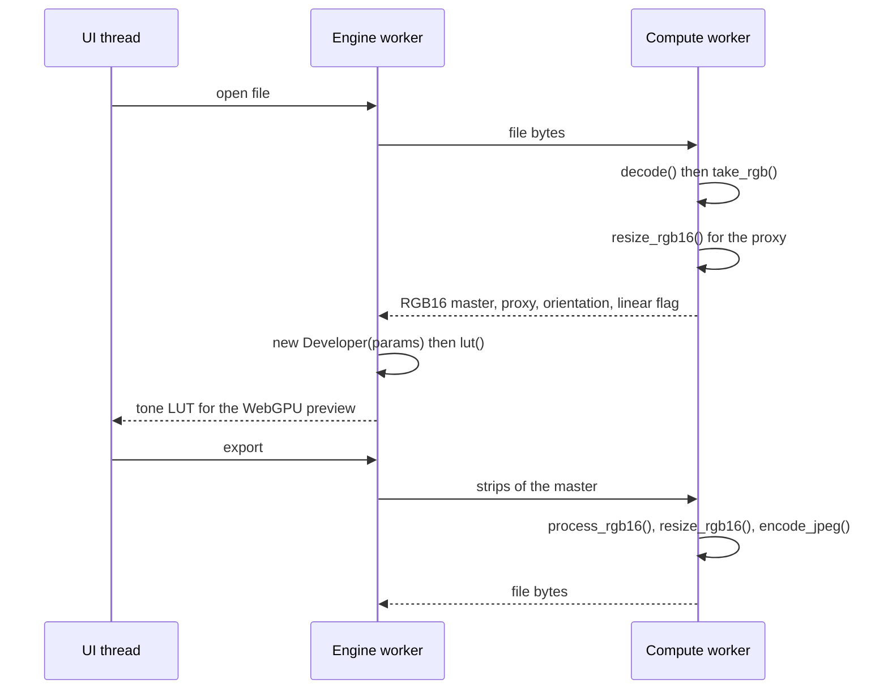
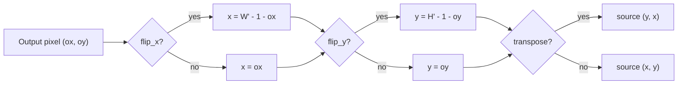
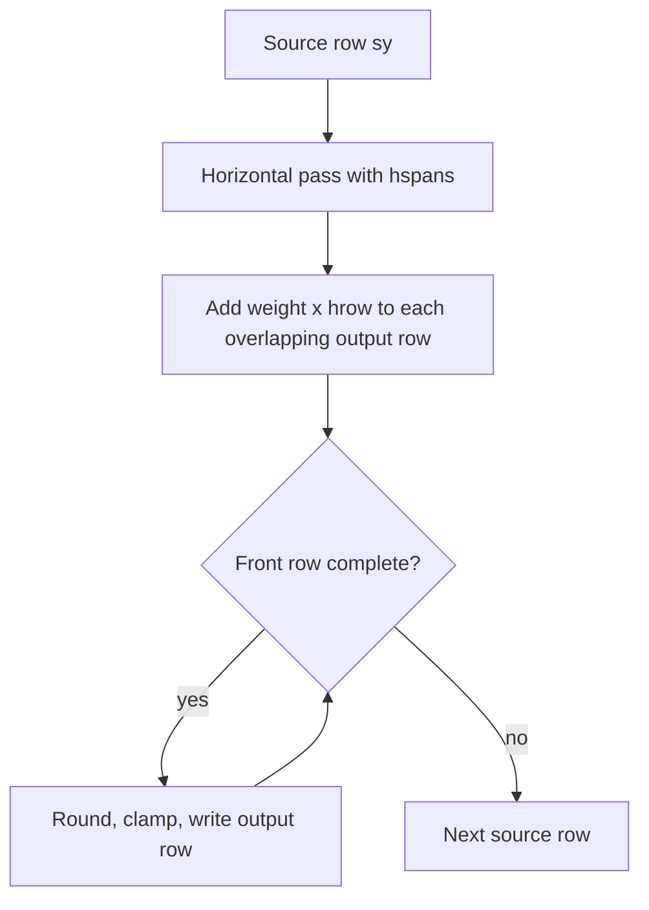
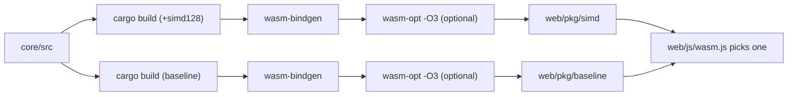

# darkroom-core

The Rust crate that does all of Darkroom's pixel work: decoding files, developing (negative inversion, white balance, tone), denoising, geometry, resizing and encoding. It is compiled to WebAssembly and loaded by the Web Workers in `web/workers/`. The JavaScript side never touches pixel maths itself; it moves `Uint16Array`s in and out of the functions exported here.

## Files

| File | Role |
|------|------|
| `src/lib.rs` | The only file that knows about JavaScript. Flat `wasm-bindgen` exports: byte and number arrays in, arrays out. |
| `src/color.rs` | sRGB transfer function, Rec.709 luma weights, 3×3 matrix helpers, the linear-sRGB → XYZ matrix. |
| `src/geometry.rs` | EXIF orientation as three booleans, output → source coordinate mapping, crop rectangles. |
| `src/resize.rs` | Streaming, separable area-average downscaling for the proxy and for export resizing. |
| `src/encode.rs` | JPEG, PNG and TIFF writers for export. |
| `src/decode/` | File bytes → 16-bit RGB, including camera raw and demosaicing. |
| `src/develop/` | Inversion, white balance, tone curves, the shared tone LUT, analysis. |
| `src/jpeg/` | Lossless JPEG crop and rotate on DCT coefficients, EXIF APP1 helpers. |
| `src/denoise/` | Grain model, wavelet, non-local means and neural denoisers. |
| `.cargo/config.toml` | Default `RUSTFLAGS` for `wasm32-unknown-unknown` (SIMD on). |
| `../build.sh` | Builds the two wasm variants into `web/pkg/simd` and `web/pkg/baseline`. |
| `tests/lossless_jpeg.rs` | End-to-end test of the lossless JPEG transcoder. |
| `examples/` | Command-line tools: `decode`, `denoise_eval`, `train_denoiser`. |

### Submodules

| Module | What it teaches | README |
|--------|-----------------|--------|
| `decode` | Format sniffing, raster decoding, camera raw development, Bayer demosaicing | [src/decode/README.md](src/decode/README.md) |
| `develop` | Negative inversion in density space, white balance, tone curves, LUTs | [src/develop/README.md](src/develop/README.md) |
| `jpeg` | JPEG structure, Huffman coding, lossless transforms of DCT blocks | [src/jpeg/README.md](src/jpeg/README.md) |
| `denoise` | Noise and grain estimation, wavelet shrinkage, non-local means, a small CNN | [src/denoise/README.md](src/denoise/README.md) |

## How it works

### The JS boundary: `lib.rs`

Everything else in the crate is plain Rust with unit tests and no `wasm-bindgen` imports. `lib.rs` wraps it in small functions whose arguments are slices and numbers, because those cross the boundary cheaply: a `&[u16]` argument is copied from a JS `Uint16Array` into wasm memory, and a returned `Vec<u16>` comes back as a new typed array. Pixel buffers are always interleaved `u16`, row-major, no padding (RGB, or RGBA for the GPU proxy). Rectangles are passed as `[x0, y0, x1, y1]` normalised floats. Structured parameters cross as JSON strings and are parsed by `Params::from_json` or `DenoiseParams::from_json`. Rust errors become `JsError` exceptions through the helper `err`.

The exports, grouped as in the file:

| Group | Exports |
|-------|---------|
| Setup | `start` (installs `console_error_panic_hook`), `simd_enabled` |
| Decoding | `decode` → `DecodedImage` (getters `width`, `height`, `orientation`, `linear`, `description`, plus `take_rgb`), `rgba8_to_rgb16` for browser-decoded fallbacks (AVIF, HEIC) |
| Proxy and resizing | `make_proxy` (downscale and add alpha = 65535, since GPUs have no 3-channel textures), `resize_rgb16`, `orient_rgb16` |
| Developing | class `Developer` (Rust `WasmDeveloper`): constructor from params JSON, `lut` (3 × 65536 floats for the GPU), `saturation`, `process_rgb16` (export strips), `render_view` (CPU preview and loupe); `histogram_rgba8` |
| Analysis | `auto_negative`, `sample_density`, `neutral_balance`, `auto_levels`, each taking params JSON, a buffer and a normalised rect |
| Encoding | `encode_jpeg` (copies the source file's EXIF with orientation reset to 1), `encode_png`, `encode_tiff` |
| Lossless JPEG | `jpeg_info` (JSON), `jpeg_lossless` → `LosslessJpeg` (`take_bytes`, `width`, `height`) |
| Denoising | `estimate_noise`, `denoise_margin`, class `Denoiser` (`new(weights)`, `run`), and the WebGPU helpers `nn_prepare` and `nn_finish` |

`DecodedImage::take_rgb` and `LosslessJpeg::take_bytes` use `std::mem::take`, so the wasm-side copy is freed as soon as JS has its own. A large raw can be hundreds of megabytes of `u16`, and keeping two copies would double peak memory.



The diagram is simplified from `web/workers/compute.worker.js` and `web/workers/engine.worker.js`. Note that the worker builds its proxy with `resize_rgb16` and adds the alpha channel in JS; the `make_proxy` export currently has no caller.

### `color.rs`: linear light and primaries

Two ideas run through the whole crate. First, light adds linearly, so exposure, white balance, averaging and film density are computed on linear values, while files store sRGB-encoded values. `srgb_to_linear` and `linear_to_srgb` implement the piecewise sRGB curve from IEC 61966-2-1:

```text
linear = v / 12.92                       if v <= 0.04045
       = ((v + 0.055) / 1.055) ^ 2.4     otherwise

encoded = v * 12.92                      if v <= 0.0031308
        = 1.055 * v ^ (1/2.4) - 0.055    otherwise
```

The short linear segment near black avoids an infinite slope at zero. Second, "RGB" only means something relative to a set of primaries. Inside Darkroom everything is sRGB / Rec.709 primaries with a D65 white. `SRGB_TO_XYZ` is the standard linear-sRGB → CIE XYZ matrix, and `LUMA` = `[0.2126, 0.7152, 0.0722]` is its Y row. `mat3_mul`, `mat3_apply` and `mat3_inverse` (inverse via the adjugate, returning `None` when `|det| < 1e-9`) are what the raw decoder uses to build its camera → sRGB matrix.

### `geometry.rs`: orientation as three booleans

A rectangle can be rotated or mirrored in 8 ways (the dihedral group D4), and these are exactly the 8 values of the EXIF `Orientation` tag. Each one can be written as *optionally transpose, then optionally flip X, then optionally flip Y*. `Orientation::from_exif` maps the codes:

| EXIF code | Meaning | transpose | flip_x | flip_y |
|-----------|---------|-----------|--------|--------|
| 1 | normal | no | no | no |
| 2 | mirror horizontal | no | yes | no |
| 3 | rotate 180° | no | yes | yes |
| 4 | mirror vertical | no | no | yes |
| 5 | transpose | yes | no | no |
| 6 | rotate 90° clockwise | yes | yes | no |
| 7 | transverse | yes | yes | yes |
| 8 | rotate 90° counter-clockwise | yes | no | yes |

Unknown codes become 1. `to_exif` is the exact inverse (a unit test round-trips all 8).

The mapping goes from an **output** pixel back to the **source** pixel, because that is the question a renderer asks: "for each pixel I draw, where do I read?" With `W', H'` the output size:

```text
x = flip_x ? (W' - 1 - ox) : ox
y = flip_y ? (H' - 1 - oy) : oy
(sx, sy) = transpose ? (y, x) : (x, y)
```

Worked example, code 6 on a 2×1 image `[a b]`: the output is 1×2. For output `(0, 1)`: `x = 1 - 1 - 0 = 0`, `y = 1`, transpose gives source `(1, 0)` = `b`. So the column reads `a` over `b`, which is the clockwise rotation (test `rotate_cw`).



The functions built on this:

- `output_size`: swaps width and height when transposed.
- `map_normalized`: the same mapping in `[0,1]` coordinates (`1 - u` instead of `W' - 1 - ox`). `develop/render.rs` uses it, and the WebGPU shader (`web/js/render/webgpu.js`) and `web/js/geometry.js` implement the same formula.
- `orient_buffer`: applies an orientation to an interleaved buffer of any sample type, by looping over output pixels and reading from the mapped source pixel. It is exported as `orient_rgb16`.
- `source_x_reversed` / `source_y_reversed`: whether a source axis runs backwards in the output. The lossless JPEG code (`jpeg/transform.rs`) needs this to decide which edge of a crop to snap to the MCU grid.
- `crop_to_source`: a crop drawn on the displayed image is in output coordinates. Because orientation only swaps and flips axes, mapping both corners through `map_normalized` and re-sorting (`min`/`max`) gives the source-space rectangle. The JS UI uses its own copy, `cropToSource` in `web/js/geometry.js`; the Rust function is the reference version.
- `PixelRect::from_norm`: rounds a normalised rect to whole pixels `[x0, x1) × [y0, y1)`, clamped, always at least 1×1.

Orientation is never baked into the decoded master. It is part of the editable state and is applied when rendering or exporting.

### `resize.rs`: streaming area downscale

`downscale_u16` makes every output pixel the exact average of the source area it covers, with partially covered source pixels weighted by the covered fraction. This box filter over fractional areas is what a bigger sensor pixel would have integrated physically, so it is a good anti-aliasing filter for reduction. It only reduces: it asserts `dw <= sw` and `dh <= sh`.

`spans` precomputes, per output index along one axis, the first contributing source index and a weight list. With `scale = src_len / dst_len`, output `o` covers source interval `[o·scale, (o+1)·scale)`, and source pixel `s` gets weight `overlap(s) / scale`. The weights in a span sum to 1.

Example, 7 → 3 pixels (`scale = 7/3 ≈ 2.33`): output 0 covers `[0, 2.33)`, so source pixels 0 and 1 get weight `1/2.33 = 0.43` each and pixel 2 gets `0.33/2.33 = 0.14`.

The filter is separable, so it streams:

1. For each source row, resample horizontally once into `hrow`.
2. Add `weight · hrow` into the accumulator of every output row that this source row overlaps (`row_targets`, usually one or two rows).
3. When the current source row was the last one contributing to the front accumulator, round, clamp to `0..=65535`, write it out and drop it.

The accumulators live in a `VecDeque`, so memory is a few output rows whatever the source height. That matters when a 60-megapixel raw is reduced to a screen proxy inside a wasm instance with limited memory.



`fit_within` computes the largest size that fits a square of `max_edge` without upscaling; `web/workers/compute.worker.js` mirrors it in JS.

### `encode.rs`: export

Input to every encoder is sRGB-encoded RGB16 from `Developer::process_rgb16`.

- `to_u8` converts 16 → 8 bits with rounding: `(v · 255 + 32767) / 65535`. Since 65535 = 255 · 257, this is exact at both ends.
- `jpeg` uses the `jpeg-encoder` crate with quality clamped to 1–100, optimised Huffman tables, and either 4:4:4 (no chroma subsampling, for archival exports) or 4:2:0. JPEG headers store dimensions as 16-bit values, so sides above 65535 are rejected. An optional APP1 segment is embedded as-is.
- `png` writes 8- or 16-bit RGB with an sRGB chunk (perceptual intent), so colour-managed viewers interpret it correctly. 16-bit samples are written big-endian, as the PNG spec requires.
- `tiff16` writes 16-bit RGB with Deflate compression.

EXIF is copied only for JPEG output from a JPEG source: `lib.rs::encode_jpeg` calls `jpeg::exif::find_app1` on the original file and `jpeg::exif::set_orientation(.., 1)`, because the pixels are already rotated and a viewer must not rotate them again.

## Build

The crate is both a `cdylib` (for wasm) and an `rlib` (for native tests and examples). The `wasm-bindgen` dependency is pinned to `=0.2.100` because the `wasm-bindgen` CLI that generates the JS glue must match it exactly.

### SIMD and baseline builds

WebAssembly SIMD (`simd128`) gives 128-bit vector instructions, which `develop/apply.rs` and `denoise/neural.rs` use explicitly (and which the compiler can also use elsewhere), but some older engines lack it. `../build.sh` therefore builds twice:

| Variant | `RUSTFLAGS` | Output |
|---------|-------------|--------|
| `simd` | `-C target-feature=+simd128 --cfg getrandom_backend="wasm_js"` | `web/pkg/simd/` |
| `baseline` | `--cfg getrandom_backend="wasm_js"` | `web/pkg/baseline/` |

Each variant uses its own `--target-dir` (`target/simd`, `target/baseline`) so the two builds don't invalidate each other's cache. The script then runs `wasm-bindgen --target web --no-typescript`, and `wasm-opt -O3` if it is installed. At runtime `web/js/wasm.js` asks `WebAssembly.validate` whether a tiny module containing one SIMD instruction is valid, and loads the matching package. `simd_enabled()` reports `cfg!(target_feature = "simd128")` so the UI can show which one is running.

`.cargo/config.toml` sets the SIMD flags as the default for `wasm32-unknown-unknown`, so a plain `cargo build --target wasm32-unknown-unknown` gives the SIMD variant. Setting `RUSTFLAGS` in the environment replaces these flags, which is how `build.sh` produces the baseline. The `getrandom_backend` cfg, together with the `uuid`/`getrandom` feature entries in `Cargo.toml`, is only needed because `rawler` pulls in crates that refuse to compile for `wasm32-unknown-unknown` without a randomness source. Darkroom itself never uses randomness at runtime.

The release profile uses `opt-level = 3`, `lto = true`, `codegen-units = 1` and `panic = "abort"`, trading compile time for a smaller and faster module.



### Tests and examples

Native tests run with:

```sh
cargo test --release --manifest-path core/Cargo.toml
```

CI (`.github/workflows/pages.yml`) runs the same command before `./build.sh`. Unit tests sit next to the code in `#[cfg(test)]` modules (for example sRGB round-trip and matrix inverse in `color.rs`, EXIF round-trip and rotation in `geometry.rs`, mean preservation in `resize.rs`, flat-field demosaic in `decode/demosaic.rs`).

`tests/lossless_jpeg.rs` is the integration test. It encodes a synthetic image with `jpeg-encoder` (baseline and progressive, 4:4:4, 4:2:0 and 4:2:2, with and without restart intervals), transforms it with `jpeg::transform`, and checks that the result matches decoding the original and cropping and rotating the pixels. It also checks MCU-grid snapping, exact coefficients and an identity round-trip.

Examples in `examples/`:

- `decode.rs`: decode one file and print size, description, orientation, transfer and time. `cargo run --release --manifest-path core/Cargo.toml --example decode -- photo.nef`
- `denoise_eval.rs`: PSNR of each denoiser on held-out Kodak images with synthetic noise and grain.
- `train_denoiser.rs`: trains the neural denoiser on the CPU, with hand-written backpropagation and Adam (uses `rayon`, a dev-dependency).

## Design choices and trade-offs

- **One narrow boundary.** Keeping `wasm-bindgen` in `lib.rs` means every algorithm can be unit-tested natively and read without JS concerns. The cost is that each call copies its input slices into wasm memory, so callers work in strips and tiles.
- **JSON for parameters, typed arrays for pixels.** Params change shape often; JSON keeps the boundary stable. Pixels are too large for JSON and go as raw arrays.
- **16-bit everywhere.** Negative inversion stretches tones a lot, and 8-bit masters would band. `u16` is the smallest type that keeps 16-bit scans and raws intact.
- **No threads.** WebAssembly threads need cross-origin isolation headers that GitHub Pages can't send. The JS pool runs several independent wasm instances instead. Most exports are therefore plain functions over the buffers they are given; the only objects that keep state between calls are `Developer` (its tone LUT) and `Denoiser` (its network weights), and each worker keeps its own.
- **Orientation as state, not pixels.** The decoder reports orientation and nothing rotates the master. Rotating a crop is then cheap, and the lossless JPEG path can work from the untouched file.
- **Box filter for reduction only.** Area averaging is exact and alias-free for downscaling but blurrier than Lanczos-type filters, and it can't upscale.
- **Two wasm builds.** Doubles build time and the deployed size, in exchange for SIMD speed where it exists and a working fallback where it doesn't.

## Further reading

- IEC 61966-2-1:1999, *Multimedia systems and equipment – Colour measurement and management – Default RGB colour space – sRGB*.
- ITU-R Recommendation BT.709, *Parameter values for the HDTV standards for production and international programme exchange* (primaries and luma weights).
- CIPA DC-008, *Exchangeable image file format for digital still cameras: Exif* (the `Orientation` tag, 0x0112).
- ITU-T T.81 | ISO/IEC 10918-1, *Digital compression and coding of continuous-tone still images* (JPEG).
- W3C, *Portable Network Graphics (PNG) Specification*: <https://www.w3.org/TR/png/>
- Adobe, *TIFF Revision 6.0*.
- WebAssembly SIMD proposal: <https://github.com/WebAssembly/simd>
- wasm-bindgen: <https://github.com/rustwasm/wasm-bindgen>
- Crates: [rawler](https://crates.io/crates/rawler), [image](https://crates.io/crates/image), [jpeg-encoder](https://crates.io/crates/jpeg-encoder), [png](https://crates.io/crates/png), [tiff](https://crates.io/crates/tiff).
