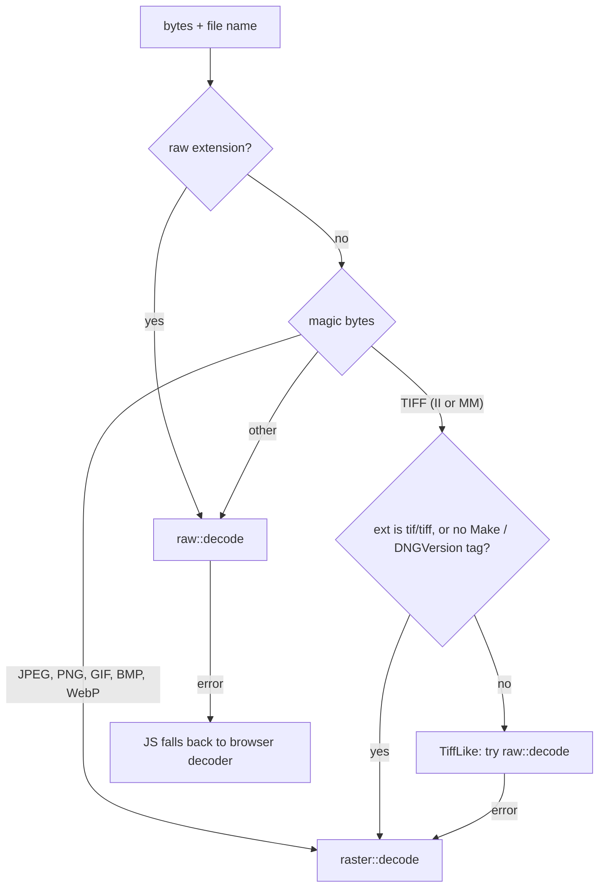
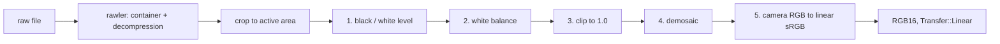
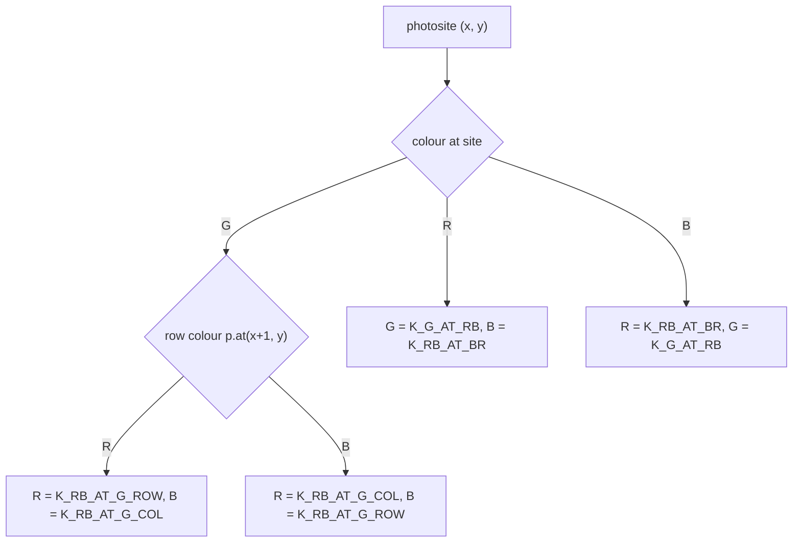

# decode

Turns file bytes into Darkroom's one internal image type: interleaved 16-bit RGB, row-major, no padding, plus a flag saying whether the values are sRGB-encoded or linear light, and the EXIF orientation found in the file. It is the first stage of the pipeline; everything after it (`develop`, `denoise`, `geometry`, `encode`) works on this "master" and never needs to know which format it came from.

## Files

| File | Role |
|------|------|
| `mod.rs` | `Decoded` and `Transfer` types, format sniffing (`sniff`, `tiff_looks_like_raw`), and the `decode` dispatcher. |
| `raster.rs` | JPEG, PNG, TIFF, WebP, BMP and GIF through the `image` crate, keeping 16-bit precision. |
| `raw.rs` | Camera raw through `rawler`, then the development steps: black and white levels, white balance, highlight clip, demosaic, colour matrix. |
| `demosaic.rs` | Malvar–He–Cutler demosaic for Bayer sensors, neighbour averaging for any other pattern. |

## How it works

### The output contract

`mod.rs::Decoded` holds `width`, `height`, `rgb: Vec<u16>`, `transfer`, `orientation` (EXIF code 1–8) and a human-readable `description` such as `"JPEG 8-bit"` or `"Raw · NIKON Z 6"`.

`Transfer` is `Srgb` or `Linear`. Ordinary 8- and 16-bit files are left sRGB-encoded rather than linearised at decode time. The develop stage folds linearisation into the same lookup table as every other tone operation, so it costs nothing there, and the user can override the guess (scanner software often writes linear TIFFs without saying so). Raw files and floating-point images come out `Linear`.

Orientation is reported, never applied. Rotation is part of the editable state (see `geometry.rs`).

### Sniffing: which decoder?

`mod.rs::sniff` decides between three kinds, `Raster`, `TiffLike` and `Raw`:

1. **Raw extension wins.** If the file name ends in one of the extensions in `RAW_EXT` (`3fr`, `arw`, `cr2`, `cr3`, `dng`, `nef`, `orf`, `raf`, `rw2`, `x3f` and others), it is `Raw`.
2. **Magic bytes.** JPEG (`FF D8 FF`), PNG (`89 'P' 'N' 'G'`), GIF (`'GIF8'`), BMP (`'BM'`) and WebP (`'RIFF' .... 'WEBP'`) are `Raster`.
3. **TIFF magic** (`'II' 2A 00` little-endian or `'MM' 00 2A` big-endian) needs a closer look, because NEF, CR2, ARW, DNG and many other raws are TIFF containers too. If the extension is `tif`/`tiff`, or the file doesn't look like a raw, it is `Raster`; otherwise `TiffLike`.
4. **Anything else is `Raw`.** CR3, RAF, ORF, RW2 and others have their own signatures, and rawler identifies them.

`tiff_looks_like_raw` reads the first image file directory (IFD). A TIFF header is the byte order, the magic 42, and a 4-byte offset to the first IFD. An IFD is a 2-byte entry count followed by 12-byte entries whose first 2 bytes are the tag number. The function returns true if any entry is `Make` (0x010F) or `DNGVersion` (0xC612). Camera files carry `Make` (and DNGs carry `DNGVersion`); scanner TIFFs usually carry neither. This check exists because raw decoders assume a camera file and can misbehave badly on an arbitrary TIFF.

`decode` then dispatches. For `TiffLike` it tries the raw decoder first and falls back to the raster decoder, combining both error messages if both fail. If the raw decoder rejects a `Raw` file (for example an AVIF or HEIC, which land in the "anything else" case), the error goes back to JS, and `web/workers/compute.worker.js` falls back to the browser's own decoder plus `rgba8_to_rgb16`.



### Raster files: `raster.rs`

`raster.rs::decode` hands the bytes to `image::ImageReader` with `with_guessed_format`, asks the decoder for its EXIF orientation before decoding (`decoder.orientation()`, default 1), then converts by sample type:

| Decoded type | Conversion | `Transfer` | Bits shown |
|--------------|------------|------------|------------|
| `Luma16`, `LumaA16`, `Rgb16`, `Rgba16` | `to_rgb16` (grey copied to R, G, B; alpha dropped) | `Srgb` | 16 |
| `Rgb32F`, `Rgba32F` | clamp to `[0,1]`, `v · 65535 + 0.5` | `Linear` | 32 |
| everything else (8-bit) | `to_rgb8`, then `v · 257` | `Srgb` | 8 |

Multiplying by 257 rather than 256 maps 255 exactly to 65535 (255 · 257 = 65535), so white stays white. Keeping 16 bits matters because a film-scanner TIFF has 256 times more tonal steps than an 8-bit JPEG, and negative inversion stretches the tonal range enough that 8 bits would band visibly. Float images are treated as scene-linear because that is the usual convention for float TIFFs.

### Camera raw: `raw.rs`

A raw file holds what the sensor measured: one number per photosite (pixel site), each behind a red, green or blue filter. The `rawler` crate handles the proprietary containers and compression (`rawler::get_decoder`, then `raw_image`) and returns a `RawImage` with the undemosaiced data, black and white levels, white-balance coefficients, the colour filter layout and colour matrices. `raw.rs::develop` does the rest in five steps.



**Crop.** Sensors have masked borders used to measure the black level. `develop` uses `raw.crop_area`, else `raw.active_area`, else the whole frame, and rejects areas that fall outside the image.

**Step 1, black and white level.** The sensor reports a non-zero value even in total darkness (the black level), and saturates at some white level below the container's maximum. Each sample is normalised so it is proportional to light and 1.0 means saturated:

```text
v = (raw - black) / (white - black)
```

The black level can vary in a small repeating pattern (for example one value per CFA position), so `black_at(x, y, c)` indexes `raw.blacklevel.levels` by `(y mod height, x mod width)` of that pattern and by channel. The white level is the first entry of `raw.whitelevel`, defaulting to 65535.

**Step 2, white balance.** Camera channels have very different sensitivities; under daylight a grey card often gives a green value well above red and blue. `raw.wb_coeffs` holds the "as shot" multipliers. If any of the first three is non-finite or not positive, `develop` falls back to `raw.neutralwb()`. They are normalised so green is 1: `wb = [R/G, 1, B/G]`. Each photosite is multiplied by the coefficient for its filter colour, so that a neutral grey reads R = G = B.

**Step 3, highlight clip.** After white balance the result is clamped to `[0, 1]`. Without this, a blown highlight where green saturated at 1.0 but red was multiplied to, say, 2.0 would come out pink after demosaic and the colour matrix. Clipping all channels to the same ceiling keeps it white. Detail in those areas is lost; this decoder does no highlight reconstruction.

Steps 1–3 run on the mosaic and produce one `f32` per photosite.

**Step 4, demosaic.** See the next section.

**Step 5, colour matrix.** A camera's red, green and blue filters are not the sRGB primaries. Each camera model has a matrix, `xyz_to_cam`, that predicts the (white-balanced) camera response to a colour given in CIE XYZ. These are the Adobe DNG `ColorMatrix` values, also tabulated in dcraw, and rawler ships them per model. `raw.rs::camera_matrix` turns one into a camera → linear sRGB matrix the way dcraw does:

```text
rgb_to_cam = xyz_to_cam · SRGB_TO_XYZ     how the camera sees each sRGB primary
normalise each row of rgb_to_cam to sum 1 so white-balanced (1,1,1) maps to sRGB (1,1,1)
cam_to_srgb = inverse(rgb_to_cam)
```

It prefers a matrix for D65, then Daylight, D55, D50, then any matrix rawler has. If none is found, the matrix has fewer than 9 entries, or it is singular, it uses the identity. Each demosaiced pixel is multiplied by `cam_to_srgb` and stored as `clamp(v, 0, 1) · 65535 + 0.5`. The result is linear sRGB, so `Transfer::Linear`.

**Non-CFA raws.** When `raw.photometric` is `LinearRaw` or `BlackIsZero` (for example a demosaiced "linear DNG", or a monochrome sensor), there is no mosaic. With one channel (`cpp == 1`) the normalised value is copied to R, G and B without white balance or matrix. With several channels, each gets black/white normalisation, white balance, clipping and the colour matrix.

**Orientation and description.** `raw.orientation` is used if it is 1–8, otherwise 1. The description is `"Raw · {clean_make} {clean_model}"`.

### The Bayer colour filter array

Most sensors put a 2×2 repeating pattern of filters over the photosites, with two greens, one red and one blue. Green is doubled because the eye's luminance sensitivity peaks there. One common layout, called RGGB after its first two rows:

```text
        x=0 x=1 x=2 x=3
  y=0   R   G   R   G
  y=1   G   B   G   B
  y=2   R   G   R   G
  y=3   G   B   G   B
```

So at every photosite one colour is measured and two are missing. Demosaicing estimates the missing two.

`raw.rs` gets the pattern from rawler (`config.cfa`), shifts it to the crop origin with `cfa.shift(cx, cy)` (the pattern is defined from the sensor origin, and an odd crop offset would turn RGGB into GRBG), and builds a `demosaic::Pattern` of colour indices 0 = R, 1 = G, 2 = B. Any index above 2 (for example a four-colour CYGM sensor) is an error.

`demosaic.rs::Pattern::is_bayer` accepts a 2×2 pattern with one R, one B and two G on a diagonal, which covers RGGB, BGGR, GRBG and GBRG. `demosaic` uses Malvar–He–Cutler for those when the image is at least 5×5, and `neighbour_average` otherwise.

### Malvar–He–Cutler demosaic

The simplest demosaic is bilinear: a missing green is the mean of the four green neighbours. It blurs edges and causes colour fringes ("zippering"), because each channel is interpolated on its own.

Malvar, He and Cutler (2004) observed that edges are mostly shared between channels: where red changes sharply, green usually does too. So they add a correction from the colour that *is* measured at the pixel. For green at a red site:

```text
G(x,y) = bilinear_G(x,y) + α · ( R(x,y) - mean of the four R at distance 2 )
```

The bracket is a discrete Laplacian of red: how much the centre differs from its surroundings. With the paper's gain α = 1/2 this becomes a fixed 5×5 linear filter. The paper chose its gains from a statistical fit over a set of test images and rounded them so every kernel is a set of small integers divided by 8. `demosaic.rs` writes the four kernels out in full, already multiplied by 8:

| Constant | Estimates |
|----------|-----------|
| `K_G_AT_RB` | green at a red or blue site |
| `K_RB_AT_G_ROW` | red or blue at a green site whose row holds that colour |
| `K_RB_AT_G_COL` | red or blue at a green site whose column holds that colour |
| `K_RB_AT_BR` | red at a blue site, or blue at a red site |

Each kernel sums to 8, so after dividing by 8 a flat field stays flat (the unit test `flat_field_stays_flat` checks this for all four Bayer phases).

#### Worked example: green at a red site

`K_G_AT_RB`, centred on a red pixel:

```text
          0   0  -1   0   0          R2 above
          0   0   2   0   0          G above
         -1   2   4   2  -1          R2 G R G R2
          0   0   2   0   0          G below
          0   0  -1   0   0          R2 below
```

The 4 is the centre red, the 2s are the four green neighbours, the −1s are the four reds two steps away. Take a grey scene with a vertical edge just right of the centre: brightness 0.2 for x ≤ 0 and 0.8 for x ≥ 1, the same in every channel and every row. The true green at the centre is 0.2.

```text
bilinear:  (G left + G right + G up + G down) / 4
         = (0.2 + 0.8 + 0.2 + 0.2) / 4                   = 0.35

MHC:       ( 4·R centre
           + 2·(G left + G right + G up + G down)
           - (R left2 + R right2 + R up2 + R down2) ) / 8
         = ( 4·0.2 + 2·1.4 - (0.2 + 0.8 + 0.2 + 0.2) ) / 8
         = ( 0.8 + 2.8 - 1.4 ) / 8                       = 0.275
```

The correction term is `(4·0.2 - 1.4) / 8 = -0.075`: the red channel says "the centre is darker than its surroundings", and that pulls the green estimate down towards the true 0.2. Bilinear's error of 0.15 shrinks to 0.075. On real images this reduction in edge error is what removes most of bilinear's colour fringing.

#### Implementation details

`malvar_he_cutler` loops over every pixel and picks kernels by the colour at that site:

- **Green site:** it checks `p.at(x + 1, y)` to see whether the row holds red or blue, then uses `K_RB_AT_G_ROW` for that colour and `K_RB_AT_G_COL` for the other.
- **Red site:** `[v, conv(K_G_AT_RB), conv(K_RB_AT_BR)]`.
- **Blue site:** `[conv(K_RB_AT_BR), conv(K_G_AT_RB), v]`.

The inner `conv` closure skips zero taps. Interior pixels index directly. Within 2 pixels of the border, coordinates are mirrored by stepping ±2, a whole pattern period, so every tap still lands on the same filter colour it would have had inside the image. Results are clamped at 0 (the negative taps can undershoot on sharp edges) but not at 1; the final `to_u16` in `raw.rs` clamps after the colour matrix.



### Fallback: neighbour averaging

For any pattern that is not 2×2 Bayer, such as Fujifilm X-Trans (6×6), `neighbour_average` keeps the measured value and sets each missing colour to the mean of same-coloured photosites in the 3×3 neighbourhood, or in the 5×5 neighbourhood if the 3×3 has none (the result is 0 if neither has one). It works for any pattern but is soft and prone to colour artefacts at edges.

## Design choices and trade-offs

- **One output type.** Every decoder emits the same `Decoded`, so the rest of the pipeline has no format branches. The cost is memory: a 16-bit RGB master is 6 bytes per pixel, even for an 8-bit JPEG.
- **Extension first for raws, magic first otherwise.** Raw extensions are reliable and raw magics are many and varied; leaving unknown magic to rawler avoids maintaining a list here.
- **The `Make`/`DNGVersion` check.** A cheap 2-tag scan of the first IFD keeps scanner TIFFs away from the raw decoder, which assumes a camera. A `.tif` extension always forces the raster path.
- **Linear output for raws, encoded output for rasters.** Raws are linear by nature; rasters are left as stored so the develop LUT can linearise for free and the user can override a wrong guess.
- **MHC over adaptive methods.** MHC is a fixed linear filter: fast, predictable, no parameters, and much better than bilinear. Edge-directed methods such as AHD or AMaZE give fewer artefacts on fine detail but are far more complex and slower.
- **Simple clipping instead of highlight recovery.** Clipping all channels at 1.0 after white balance guarantees neutral highlights but discards whatever the unsaturated channels still knew.
- **A single matrix, no profiles.** One D65-ish matrix per camera, as in dcraw, rather than DNG dual-illuminant interpolation or camera profiles. Colour is good under daylight and less exact under tungsten.
- **X-Trans and other non-Bayer patterns get the simple fallback** (the top-level README lists this as a known limitation).

## Further reading

- H. S. Malvar, L. He, R. Cutler, "High-quality linear interpolation for demosaicing of Bayer-pattern color images", *Proc. IEEE ICASSP*, 2004.
- B. E. Bayer, "Color imaging array", US Patent 3,971,065, 1976.
- Adobe, *Digital Negative (DNG) Specification* (ColorMatrix, black and white levels, CFA pattern tags).
- Adobe, *TIFF Revision 6.0* (header and IFD layout).
- CIPA DC-008, *Exchangeable image file format for digital still cameras: Exif* (`Orientation`, `Make`).
- IEC 61966-2-1:1999, sRGB colour space.
- Dave Coffin, *dcraw* (the reference for the camera-matrix construction used here).
- rawler, part of dnglab: <https://github.com/dnglab/dnglab>, crate <https://crates.io/crates/rawler>
- image crate: <https://crates.io/crates/image>
