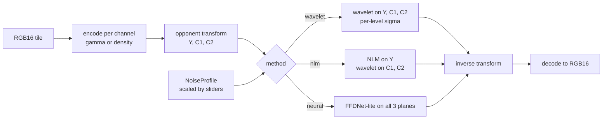
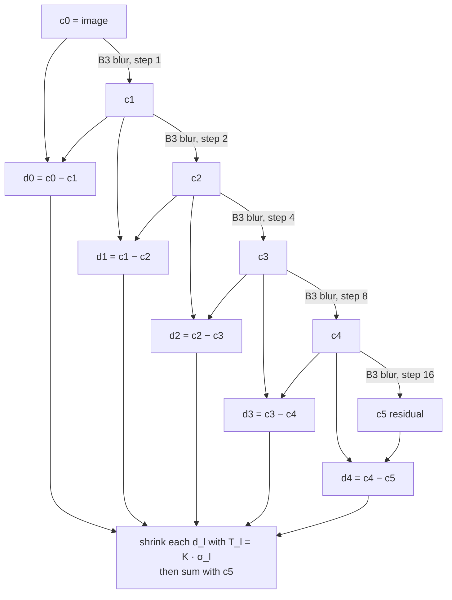
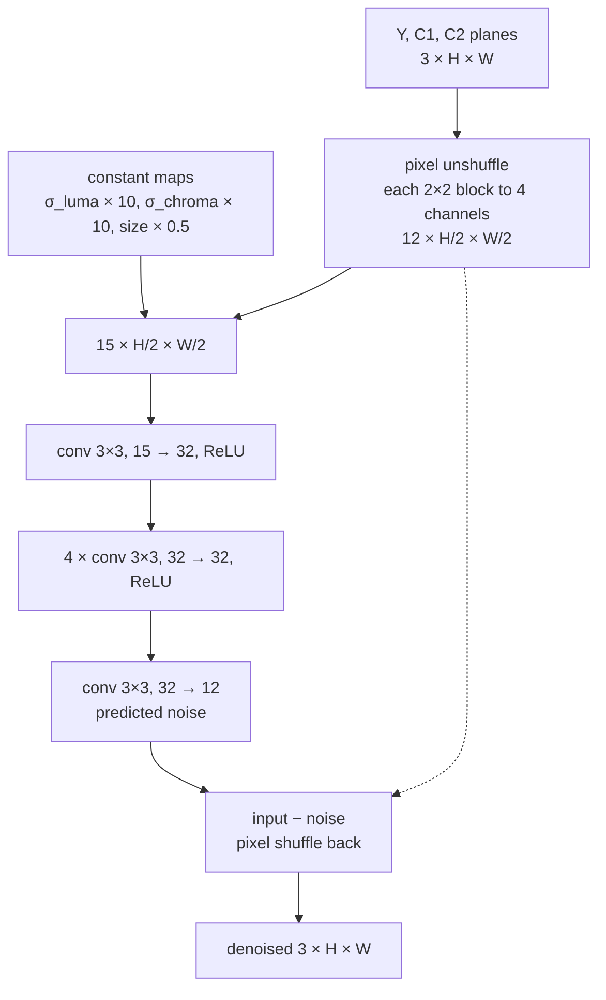
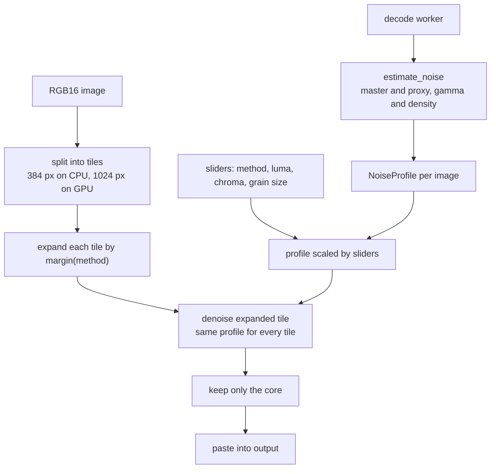

# Denoise

Noise reduction tuned for film grain, with ordinary digital noise handled as a special case. Denoising is the only *spatial* develop step, because each output pixel depends on its neighbours. For that reason it runs as a separate pass on the 16-bit master **before** the per-pixel tone lookup table: `master → denoise → tone LUT → output`. Negatives are denoised before they are inverted.

## Files

| File | Role |
|---|---|
| [`mod.rs`](mod.rs) | Entry points `denoise_rgb16`, `estimate_noise`, `margin`. The working space: `Domain` (gamma or density), `encode`/`decode`, and the orthonormal opponent transform in `Planes`. |
| [`grain.rs`](grain.rs) | `NoiseProfile` (σ luma, σ chroma, grain size, per-level measurements), grain synthesis (`grain_field`, `Rng`), the size calibration table, and `estimate`. |
| [`wavelet.rs`](wavelet.rs) | À trous B3-spline decomposition (`decompose_levels`) and non-negative garrote shrinkage (`denoise`). |
| [`nlm.rs`](nlm.rs) | Non-local means, computed with the offset / box-sum method. |
| [`neural.rs`](neural.rs) | FFDNet-lite: weight file parser, `prepare` (pixel unshuffle and noise maps), `conv3x3` (SIMD), `forward`, `finish`. |
| [`../../examples/train_denoiser.rs`](../../examples/train_denoiser.rs) | Trains the network from scratch on the CPU, with hand-written backprop and Adam. |
| [`../../examples/denoise_eval.rs`](../../examples/denoise_eval.rs) | Compares the three methods by PSNR on held-out Kodak images. |
| [`../../../web/js/nn/webgpu-denoise.js`](../../../web/js/nn/webgpu-denoise.js) | The same network as WebGPU compute shaders. |

The wasm bindings are in `core/src/lib.rs` (`estimate_noise`, `denoise_margin`, `Denoiser::run`, `nn_prepare`, `nn_finish`). Tiling is done in `web/workers/engine.worker.js` → `denoiseImage`.

## How it works

### Overall flow



`mod.rs` → `denoise_rgb16` does every step in this diagram. The noise profile is passed in, never measured inside, so all tiles of one image use the same numbers.

### 1. The working space

**An encoding where the noise is even.** Every method assumes one noise level for the whole image (per wavelet level). So the planes are first put in the encoding where that is closest to true. `Domain` has two options, chosen by `Domain::for_negative`:

- `Domain::Gamma`, for positives and digital files. Sensor noise is mostly shot noise, and its σ grows like √signal. A gamma encoding roughly evens it out, like a cheap Anscombe transform. sRGB code values are used as they are. Linear data is raised to `1/GAMMA` with `GAMMA = 2.2`.
- `Domain::Density`, for negatives. `encode` converts to linear transmittance `t`, then computes `−log10(max(t, 1e-4)) / DENSITY_SCALE` with `DENSITY_SCALE = 4`, so densities 0…4 map to 0…1. Grain belongs to the developed film, and its granularity is much more uniform in density than in scanner code values. The inversion (in `develop/tone.rs`) later stretches the thin parts of the negative, which become the shadows of the print, and it stretches the grain there too. So denoising in density, *before* inversion, matters most for underexposed and fast film.

`encode` is evaluated once into a 65 536-entry table in `Planes::from_rgb16`, so there is no `pow` or `log` per sample.

**Luminance and chrominance.** RGB is rotated with an orthonormal opponent transform:

```text
Y  = (R + G + B)  / √3     brightness, range 0…√3
C1 = (R − B)      / √2     blue ↔ red
C2 = (R − 2G + B) / √6     green ↔ magenta
```

The three row vectors `(1,1,1)/√3`, `(1,0,−1)/√2` and `(1,−2,1)/√6` each have length 1 and are mutually perpendicular (each dot product is 0). That means two things:

1. Independent noise of σ in R, G and B is still independent noise of exactly σ in Y, C1 and C2. Noise levels carry over without any correction factors.
2. The inverse is the transpose. `Planes::to_rgb16` uses that directly, with no matrix inversion.

Splitting brightness from colour lets the two be treated differently. Our eyes see colour at low resolution, so colour blotches can be removed aggressively, while luminance detail has to be kept.

### 2. The grain model (`grain.rs`)

Digital noise is roughly *white*: each pixel's noise is independent of its neighbours'. Film grain is not. A silver grain or dye cloud spans several scanner pixels, so grain comes in clumps. The model is:

```text
grain = σ · normalise( gaussian_blur( white_noise, size ) )
```

`size = 0` is digital noise, and 1–3 px is typical of film scanned at 2000–4000 dpi. This is not a physical model of grains (that would be a Boolean model of random disks, see Newson et al.), but it captures what a denoiser needs: *how much noise there is at each scale*. `grain_field` implements it, using SplitMix64 and Box–Muller in `Rng`.

`NoiseProfile` holds:

| field | meaning |
|---|---|
| `luma`, `chroma` | per-pixel σ of the grain in Y and in the chroma planes |
| `size` | radius (px) of the Gaussian that shapes the grain |
| `measured` | `Option<([f32; 5], [f32; 5])>`: σ measured directly in each wavelet level, for luma and chroma |

`NoiseProfile::levels` turns a profile into the expected σ for each of the 5 wavelet levels. Levels 0–2 (`MEASURED_LEVELS = 3`) use the direct measurements when there are any. Levels 3–4 come from the model via `level_sigmas(σ, size)`. The reason for the split: real scans are a *mixture* of fine scanner noise, film grain and the photo's own texture, and a single (σ, size) pair can't describe a mixture exactly. In flat areas the fine levels contain little besides noise, so measuring them directly is reliable. At coarse levels, image content creeps into the measurement, so the model is used there. `NoiseProfile::scaled` multiplies everything by the luma and chroma strength sliders.

#### Calibration table

`table()` is built once (`OnceLock`). For each of the 13 sizes in `SIZES` (0, 0.25, …, 2.0, 2.5, …, 4.0) it synthesises a 192×192 unit-σ grain field with seed 42, decomposes it into wavelet levels, and records the RMS of each level. Two lookups use the table:

- `level_sigmas(σ, size)`: interpolate linearly between table rows and multiply by σ. This is the forward model.
- `size_from_ratio(r)`: the inverse. Blurring moves energy from level 0 into level 1, so the ratio `σ(level 1) / σ(level 0)` grows with grain size. The function finds the table rows whose ratio brackets `r` and interpolates. Below the size-0 ratio it returns 0, and above the last row it returns `MAX_SIZE = 4`.

#### Estimation (`grain.rs` → `estimate`)

`mod.rs` → `estimate_noise` first cuts a central window of at most 1024×1024 and converts it to planes. Then `estimate`:

1. Decomposes Y into 5 wavelet levels.
2. Splits the window into 16×16 blocks (images under 64 px on a side return a zero profile). A block's "busyness" is the sum of `|coefficient|` in **level 4** (step 16, structures roughly 16–32 px across). Even coarse grain has almost no energy at that scale, but real detail does, so busyness picks out flat areas without being biased by the grain being measured.
3. Skips blocks whose mean `Y/√3` is outside 0.12…0.88. Near black or white the grain is clipped, so it looks smaller and weaker than it is.
4. Sorts by busyness and keeps the flattest quarter (at least one block).
5. Measures σ in levels 0–2 of Y over those blocks with the **MAD estimator**, `mad_sigma`: `median(|d|) / 0.6745`. For Gaussian noise, the median absolute value is 0.6745·σ. A median, unlike a standard deviation, is barely moved by the few large coefficients that come from leftover edges. The chroma σ for each level is the mean of the MAD estimates for C1 and C2.
6. `size = size_from_ratio(s1 / s0)`. Then `luma = s0 / level_sigmas(1, size)[0]` converts the level-0 σ back to a per-pixel σ, and chroma is converted with the same gain.

The worker measures every image four times: on master and proxy (downscaling averages grain away, so the proxy has less), and in both domains (`web/workers/compute.worker.js` → `decode`). If the user overrides the grain size, only `[luma, chroma, size]` is passed on. That drops `measured`, so the pure model is used (`lib.rs` → `profile`).

### 3. Wavelet shrinkage (`wavelet.rs`)

The **à trous** ("with holes") transform splits a plane into detail levels at doubling scales, plus a smooth residual:

```text
c0 = image
c1 = blur(c0, step 1)    d0 = c0 − c1     finest detail, and most white noise
c2 = blur(c1, step 2)    d1 = c1 − c2
…
c5 = blur(c4, step 16)   d4 = c4 − c5
image = d0 + d1 + d2 + d3 + d4 + c5      exact, by construction
```

`blur` is the separable B3-spline kernel `[1 4 6 4 1] / 16`. At level `l` its taps are spaced `2^l` pixels apart, which is where the "holes" are. Nothing is downsampled, so every level has full resolution and the transform is shift-invariant, which avoids the blocky artefacts of decimated wavelets. Edges are mirrored.



Real detail gives a few large coefficients, and noise gives many small ones. `wavelet::denoise` shrinks each coefficient with the **non-negative garrote** (`shrink`):

```text
T = K · σ_l              K = 1.5
d' = 0                   if d² ≤ T²
d' = d · (1 − T²/d²)     = d − T²/d otherwise
```

Unlike soft thresholding, which subtracts T from everything and so dulls strong edges, the garrote leaves large coefficients almost untouched. Unlike hard thresholding, it has no jump at T, so it doesn't leave isolated speckles. `K = 1.5` was tuned on film grain with `denoise_eval`. The source notes that about 1.9 scores slightly better on purely digital noise.

The per-level σ is what makes this work on film. For white noise most of the energy is in level 0. For 2 px grain much more of it is in levels 1–2, and a denoiser that only thresholded level 0 would leave the clumps behind. `NoiseProfile::levels` supplies the right σ for each level.

**Worked example.** Take σ₀ = 0.02 at level 0, so T = 1.5 × 0.02 = 0.03 and T² = 0.0009:

| d | garrote d − T²/d | soft (d − T) | hard |
|---|---|---|---|
| 0.010 | 0 | 0 | 0 |
| 0.030 | 0 | 0 | 0 (at the threshold) |
| 0.040 | 0.040 − 0.0225 = 0.0175 | 0.010 | 0.040 |
| 0.060 | 0.060 − 0.015 = 0.045 | 0.030 | 0.060 |
| 0.150 | 0.150 − 0.006 = 0.144 | 0.120 | 0.150 |

The strong edge (0.15) keeps 96 % of its height under the garrote but only 80 % under soft thresholding.

### 4. Non-local means (`nlm.rs`)

A plain blur averages a pixel with its *spatial* neighbours, which smears edges. Non-local means averages it with every pixel in a search window whose *surrounding patch* looks similar. Along an edge, the similar patches lie along the edge, so the edge survives:

```text
out(p)  = Σ_q w(p,q) · in(q) / Σ_q w(p,q)
w(p,q)  = exp( −max(d²(p,q) − 2σ², 0) / h² )
d²(p,q) = mean squared difference between the 5×5 patches around p and q
h       = H · (1 + H_PER_GRAIN · size) · σ       H = 0.85, H_PER_GRAIN = 0.35
```

- `SEARCH = 5` (an 11×11 window) and `PATCH = 2` (5×5 patches).
- Subtracting `2σ²` accounts for noise: two noisy copies of the *same* patch differ by 2σ² on average, so they should get full weight.
- `H_PER_GRAIN` widens `h` for clumped grain. A 5×5 patch then holds fewer independent noise samples, so distances between matching patches vary more.
- The centre pixel's own distance is 0, which would swamp everything else. It gets the largest weight any neighbour received (`wmax`) instead, which is standard practice.
- `exp` comes from a 4097-entry `ExpTable` over [0, 8). It is called about 120 times per pixel.

**The fast formulation.** Computed directly, each pixel costs search² × patch² operations. The loop is turned inside out to run over *offsets* `(dx, dy)` (Darbon et al. 2008). For each of the 120 offsets:

1. Compute the squared-difference image `(in(x) − in(x + offset))²` once, including a `PATCH`-wide border.
2. Take horizontal box sums over the patch width.
3. Take vertical box sums. That gives every pixel's patch distance for this offset at once. Turn it into a weight and accumulate `acc`, `wsum` and `wmax`.

Box sums are separable, so the patch² factor becomes 2·(2·PATCH+1). The image is padded by `SEARCH + PATCH` with repeated edges, so the inner loops index directly.

**Worked example.** σ = 0.02 and digital noise (size 0): h = 0.85 × 0.02 = 0.017, h² = 0.000289, 2σ² = 0.0008.

| patch d² | (d² − 2σ²)/h² | weight |
|---|---|---|
| 0.0008 (noise only) | 0 | 1.00 |
| 0.0011 | 1.04 | 0.35 |
| 0.0020 | 4.15 | 0.016 |

With 2 px grain, h = 0.85 × 1.7 × 0.02 = 0.0289 and the d² = 0.0020 patch now gets weight exp(−1.44) ≈ 0.24. Clumped grain needs that tolerance, but it also means NLM starts averaging across genuinely different patches.

`denoise_rgb16` runs NLM on Y only. C1 and C2 go through the wavelet method, because colour noise is low-frequency blotches that wavelets handle well, and NLM on colour would be slow for little gain.

### 5. The neural network (`neural.rs`)

FFDNet-lite is a small version of FFDNet (Zhang, Zuo & Zhang 2018):



- **Pixel unshuffle** (`prepare`): each 2×2 block becomes 4 channels, so the 3 planes become 12 channels at half resolution. The convolutions run at a quarter of the pixel count, and the receptive field in full-resolution pixels doubles. No pixel is thrown away. Odd sizes are padded by repeating the last row or column.
- **Noise maps** (from FFDNet): channels 12–14 are constants, `luma · SIGMA_SCALE`, `chroma · SIGMA_SCALE` and `size · SIZE_SCALE` (`SIGMA_SCALE = 10`, `SIZE_SCALE = 0.5`), which keeps all inputs of order 1. One network covers every noise level, and the strength sliders work by telling it the noise is stronger or weaker than measured. The grain size map tells it whether it is looking at white noise or clumps. It does not use the per-level `measured` values.
- **Residual output** (from DnCNN): the last layer predicts the *noise* (12 channels), and `finish` subtracts it while undoing the unshuffle. Noise is easier to learn than the clean image, and "no noise" is the trivial output.
- `LAYERS = 6`, `FEATURES = 32`. That is 44 812 parameters and about 11 000 multiply-adds per output pixel. A ReLU follows every layer except the last. Convolutions use zero padding.

**DRNN weight file** (little-endian), written by `Network::to_bytes`, read by `Network::parse` and by `parseWeights` in JS:

```text
"DRNN"   u32 version = 1   u32 layer_count
per layer:  u32 in_channels   u32 out_channels
            f32 weights[out][in][3][3]
            f32 bias[out]
```

`parse` rejects a file unless the first layer takes 15 channels and the last outputs 12. The shipped `web/models/denoise.bin` is 12 + 6×8 + 44 812×4 = 179 308 bytes.

**CPU inference** (`conv3x3`): for each output channel and row, the row is filled with the bias, and then for every input channel and kernel row three `axpy` calls add shifted copies of the source row (offset −1, 0, +1 in x). Each `axpy` is a long contiguous run. In the `simd128` build it is four lanes at a time with `f32x4_mul` / `f32x4_add`, and in the fallback build it is a plain loop. This layout keeps one output row in cache and avoids gathers.

**GPU inference** ([`web/js/nn/webgpu-denoise.js`](../../../web/js/nn/webgpu-denoise.js)): only the convolutions run on the GPU. `nn_prepare` and `nn_finish` in `lib.rs` still do the colour transform, unshuffle and subtraction in Rust, so there is one implementation of everything else. Each layer is one compute dispatch with 8×8 workgroups and `z = cout / 4`. Each invocation computes one pixel for four output channels as a `vec4f`, so `packWeights` reorders the weights to `[cout/4][cin][9][4]`. Activations ping-pong between two storage buffers, and only the final 12 channels are read back. Runs are serialised through a promise queue because they share buffers. In the browser console, `compareNeural` checks GPU against wasm.

### 6. Training (`core/examples/train_denoiser.rs`)

Everything a framework would normally hide is written out in this file.

- **Data**: the Kodak suite, kodim01–21 for training and kodim22–24 held out. `load` halves each image with a 2×2 box average, because the Kodak images are film scans with their own grain, and the network must not learn that grain is "clean". `make_sample` takes a random 64×64 crop (`PATCH`), applies one of 8 rotations or mirrors, and raises it to a random power `curve` ∈ [0.6, 1.6). Half the patches are then inverted (`negative_like`) to look like a negative in density space.
- **Synthetic grain** (`GrainSpec::random`):
  - σ is uniform up to `MAX_SIGMA = 50/255`, or 0 for 1 patch in 25.
  - size is 0 for 1 patch in 4, otherwise uniform in 0–3 px (`MAX_GRAIN`).
  - Colour correlation between channels is 1 (monochrome silver grain) for 1 patch in 5, otherwise uniform in 0–0.8. Each channel's grain is `√ρ · shared + √(1−ρ) · own`.
  - Per-channel multipliers are 0.8–1.2, and blue gets up to +0.4 more, because the blue layer is usually grainiest.
  - Amplitude depends on tone: `m = max(1 + tone · (luma − 0.5), 0.2)`.
  - For 1 patch in 3, white "scanner" noise up to 8/255 is added on top.
- **Target and input**: the target is the noise (noisy minus clean) in Y/C1/C2, unshuffled to 12 channels. The network is told the *realised* σ of that noise and the grain size, each multiplied by a ±15 % jitter, because at run time these numbers come from the estimator.
- **Loss and gradients**: MSE. `conv3x3_backward` computes `dW` (a correlation of input and output gradient), `db` (a sum) and `dX` (a transposed convolution). ReLU passes gradient only where the activation was positive. Each sample in a batch of 16 runs on its own rayon thread, and the gradients are averaged.
- **Optimiser**: He initialisation, with the last layer scaled by 0.1 so the network starts by predicting about zero noise. Adam (β₁ 0.9, β₂ 0.999, ε 1e-8, bias-corrected). The cosine learning-rate schedule runs from 1e-3 down to 2e-5: `lr = 2e-5 + ½(1e-3 − 2e-5)(1 + cos(π · step/steps))`.
- **Checking**: every 250 steps it reports validation PSNR on a fixed set (σ 20/255, 1.5 px) and writes the weights. Passing `gradcheck` as the step count compares analytic gradients for 3 random weights per layer with central differences (ε = 3e-3).

The default is 6000 steps. The top-level README's command passes 8000.

### 7. Tiling, and why tiles match the whole image



`web/workers/engine.worker.js` → `denoiseImage` cuts the image into tiles so the work can be spread across the worker pool in bounded memory. Each tile is processed with `margin(method)` extra pixels of context on each side, and only its core is kept. That gives the same pixels as one big call for three reasons:

- **Every method has a finite reach.** Wavelet: 2·(1+2+4+8+16) = 62 px, so `wavelet::MARGIN = 64`. NLM: `SEARCH + PATCH + 1 = 8`, but its chroma goes through the wavelet method, so the NLM margin is 64 too. Neural: 6 layers of 3×3 at half resolution reach ±12 px, so `neural::MARGIN = 16`. Pixels in the core never see the tile's artificial edge.
- **The profile is measured once per image**, not per tile, and passed in explicitly.
- **The 2×2 grid stays aligned.** Tile origins are multiples of an even tile size and the neural margin is even, so a tile's pixel unshuffle groups the same pixels as the whole image would.

`mod.rs` → `tiles_with_margin_match_whole_image` tests this for all three methods, in both domains, to within 1 code value.

### 8. Evaluation (`core/examples/denoise_eval.rs`)

For kodim22–24, `denoise_eval` adds grain with `grain_field` (shared and per-channel parts at a fixed correlation) to the sRGB code values. It estimates the profile with `estimate_noise` in `Domain::Gamma`, exactly as the app does, runs each method, and prints PSNR, timing and the measured σ and size. Results with the shipped weights, as mean PSNR in dB (from the top-level README):

| condition | grainy input | wavelet | NLM | neural |
|---|---|---|---|---|
| digital noise (σ 15) | 24.7 | 29.2 | **29.8** | 26.4 |
| ISO 400 colour (σ 12, 1 px) | 26.6 | 28.9 | 29.0 | **29.5** |
| ISO 800 colour (σ 18, 1.5 px) | 23.1 | 26.6 | 26.0 | **27.3** |
| ISO 3200 B&W (σ 22, 2 px) | 21.4 | 25.2 | 23.4 | **25.8** |
| pushed colour (σ 30, 2.5 px) | 18.8 | 22.9 | 21.4 | **23.0** |

The evaluation covers positives in gamma space only. The density path for negatives is not scored.

**When to pick which:**

- **Film grain: neural.** It wins in every grain condition. The noise maps let it adapt to the measured size.
- **Digital noise: NLM.** Fine white noise is where patch matching works best. The network is weakest here, probably because its training mix leans towards grain.
- **Fast, and close behind on film: wavelet.** It has no learned parts, and its only tuning is `K`. NLM falls behind as the grain gets coarser, because the clumps are nearly as large as its 5×5 patches, so "similar patch" often just means "similar grain".

## Design choices and trade-offs

- **One model, many methods.** All three methods are driven by the same `NoiseProfile`, so the automatic measurement and the sliders behave the same whichever method is chosen.
- **Gaussian-blurred grain** is a deliberately simple stand-in for real grain. It is enough to predict energy per scale, and it is cheap to simulate for both calibration and training. It does not capture grain that varies with density within one image, except through the per-level measurements and the training's tone dependence.
- **Measure fine levels, model coarse ones.** Direct measurements are trustworthy only where flat areas hold mostly noise. The hybrid in `NoiseProfile::levels` uses each source where it is reliable.
- **Garrote over soft or hard thresholding**: better edge retention than soft, no speckle like hard.
- **NLM on luma only.** Chroma goes to the wavelet method, which is cheaper and good at low-frequency colour blotches.
- **A tiny network.** 6 layers × 32 features fits in about 180 KB, trains on a CPU in under an hour, and runs per tile in the browser. Larger published models denoise better but cost 10–100× more.
- **Shared preparation, GPU convolutions only.** Keeping `prepare`/`finish` in Rust means the GPU and wasm paths cannot drift apart, apart from floating-point rounding.
- **Exact tiling over approximate blending.** Margins cost some redundant work, especially the 64 px for wavelet on 384 px tiles, but there are no seams and no blending heuristics.

## Further reading

- A. Buades, B. Coll, J.-M. Morel, "A non-local algorithm for image denoising", CVPR 2005.
- J. Darbon, A. Cunha, T. F. Chan, S. Osher, G. J. Jensen, "Fast nonlocal filtering applied to electron cryomicroscopy", ISBI 2008 (the offset and integral-image formulation of NLM).
- M. J. Shensa, "The discrete wavelet transform: wedding the à trous and Mallat algorithms", IEEE Trans. Signal Processing, 1992.
- J.-L. Starck, F. Murtagh, J. Fadili, *Sparse Image and Signal Processing*, Cambridge University Press (the starlet / à trous B3-spline transform).
- L. Breiman, "Better subset regression using the nonnegative garrote", Technometrics, 1995.
- H.-Y. Gao, "Wavelet shrinkage denoising using the non-negative garrote", J. Computational and Graphical Statistics, 1998.
- D. L. Donoho, I. M. Johnstone, "Ideal spatial adaptation by wavelet shrinkage", Biometrika, 1994 (the MAD noise estimate and universal threshold).
- K. Zhang, W. Zuo, L. Zhang, "FFDNet: Toward a fast and flexible solution for CNN-based image denoising", IEEE TIP, 2018. [arXiv:1710.04026](https://arxiv.org/abs/1710.04026)
- K. Zhang, W. Zuo, Y. Chen, D. Meng, L. Zhang, "Beyond a Gaussian denoiser: Residual learning of deep CNN for image denoising" (DnCNN), IEEE TIP, 2017. [arXiv:1608.03981](https://arxiv.org/abs/1608.03981)
- W. Shi et al., "Real-time single image and video super-resolution using an efficient sub-pixel convolutional neural network", CVPR 2016 (pixel shuffle).
- D. P. Kingma, J. Ba, "Adam: A method for stochastic optimization", ICLR 2015. [arXiv:1412.6980](https://arxiv.org/abs/1412.6980)
- I. Loshchilov, F. Hutter, "SGDR: Stochastic gradient descent with warm restarts", ICLR 2017 (cosine schedule).
- A. Newson, J. Delon, B. Galerne, "A stochastic film grain model for resolution-independent rendering", Computer Graphics Forum, 2017.
- [Kodak Lossless True Color Image Suite](https://r0k.us/graphics/kodak/).
