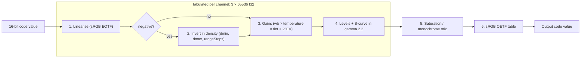
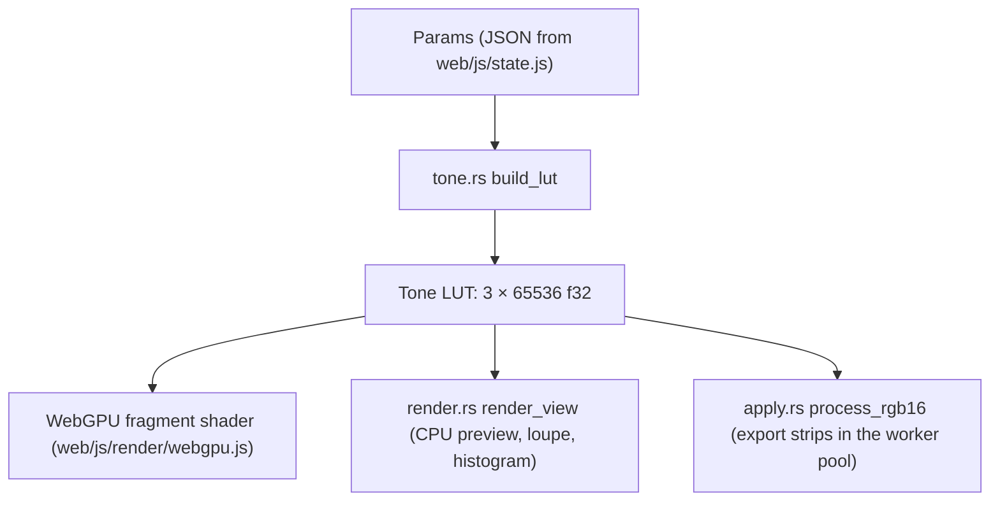

# Develop pipeline

This module turns a stored 16-bit code value into a display value: it linearises the input, inverts negatives in optical density, applies white balance and exposure, sets levels and contrast, mixes saturation, and encodes to sRGB. Decoding (`core/src/decode/`) and optional noise reduction (`core/src/denoise/`) run before it. Export encoding, preview drawing and the histogram run after it. Every per-channel step is collapsed into one lookup table, so the GPU preview, the CPU preview and the export all use the same maths.

## Files

| File | Role |
|---|---|
| `mod.rs` | Module overview, `LUT_SIZE = 65536`, and `Developer`, which bundles `Params`, the tone LUT and the `Look` (saturation). |
| `params.rs` | `Params`: the user-facing settings, deserialised from JSON. Mirrors `defaultParams()` in `web/js/state.js`. |
| `tone.rs` | The per-channel maths, one small function per step (`linearize`, `density`, `invert_negative`, `channel_gains`, `tone`), plus `build_lut`, which tabulates the chain. |
| `apply.rs` | Runs the LUT over pixels for export (`Developer::process_rgb16`), with a hand-written WebAssembly SIMD loop, the saturation mix (`Look::mix`) and the sRGB output table (`oetf_table`). |
| `analysis.rs` | Automatic settings from image statistics: `auto_negative`, `sample_density`, `neutral_balance`, `auto_levels`. |
| `render.rs` | `render_view`: the CPU twin of the WebGPU shader (orient, crop, scale, develop, 8-bit sRGB), and `histogram_rgba8`. |

## How it works

### The order of operations

For each channel `c` and each 16-bit input code `v` (normalised to `code = v / 65535`), `tone.rs` → `channel_curve` computes:

1. **Linearise** (`linearize`). Most files store sRGB-encoded values, which are roughly the cube root of light. Arithmetic on light (gains, densities, averages) has to happen on linear values, so the sRGB EOTF (`color.rs` → `srgb_to_linear`) undoes the encoding. Raw files and linear scanner TIFFs set `input_linear` and skip this.
2. **Invert a negative** (`invert_negative`), only when `negative` is set. See [Film physics](#film-physics-and-negative-inversion) below.
3. **Gains** (`channel_gains`). White balance, temperature, tint and exposure all multiply linear light, so they combine into one gain per channel:
   ```
   t = temperature × 0.5        m = tint × 0.5        ev = 2^exposure
   gain R = wb[0] × 2^( t + m/2) × ev
   gain G = wb[1] × 2^(-m)       × ev
   gain B = wb[2] × 2^(-t + m/2) × ev
   ```
   So `temperature = 1` pushes red up half a stop and blue down half a stop. `tint = 1` pulls green down half a stop and lifts red and blue a quarter stop each, which reads as magenta. `pre_balance` returns the value before this step, and `scene_linear` returns it after.
4. **Levels and contrast** (`tone`), in a perceptual space, a plain power `GAMMA = 2.2`:
   ```
   t = linear^(1/2.2)
   t = clamp((t − black) / (white − black), 0, 1)
   pivot = 0.18^(1/2.2) ≈ 0.4587           (middle grey)
   k = max(contrast, 0.05)
   t < pivot:  t = pivot × (t / pivot)^k
   otherwise:  t = 1 − (1 − pivot) × ((1 − t) / (1 − pivot))^k
   result = t^2.2                            (back to linear)
   ```
   Levels are set in gamma space because that is where "move the black point a little" looks like an even change. The contrast curve fixes 0, 1 and middle grey, and bends the two halves with mirrored power functions. `k > 1` gives an S-curve, like a harder paper grade, and `k < 1` flattens it. Each half is monotonic for any `k > 0`, so tones can never swap order (the test `contrast_curve_is_monotonic` checks this).

Steps 1 to 4 are the LUT. The last two steps mix channels or encode for output, so they run per pixel after the table reads:

5. **Saturation / monochrome** (`apply.rs` → `Look::mix`). Rec. 709 luminance `y = 0.2126 R + 0.7152 G + 0.0722 B` (`color.rs` → `LUMA`), then each channel becomes `clamp(y + (c − y) × s, 0, 1)`. `monochrome` sets `s = 0` (`Look::from_params`). This step needs all three channels at once, so it cannot go in a per-channel table.
6. **sRGB encode** (`apply.rs` → `oetf_table`). The linear result is quantised to 16 bits and looked up in a 65,536-entry table of `linear_to_srgb`, which gives a 16-bit sRGB code value for the file.



### Why a LUT

A channel stored in 16 bits has only 65,536 possible inputs, and steps 1 to 4 treat each channel on its own. So instead of running several `log10` and `powf` calls for every pixel, `tone.rs` → `build_lut` evaluates the chain once per possible input and stores the answers: `lut[c * LUT_SIZE + code]`, 3 × 65,536 `f32` values (768 KB). Developing a pixel then costs three table reads plus the saturation arithmetic, whatever the settings are.

The table is the one shared artefact between three consumers:



`lib.rs` exposes `Developer.lut()` so the engine worker can send the table to the UI thread, which uploads it to a GPU storage buffer (`setLut` in `webgpu.js`). Moving a slider then costs one table build, one 768 KB upload and one draw. Because the GPU shader, `render_view` and `process_rgb16` all read the same table, there is only one implementation of the tone maths to keep correct.

### KNOT_STEP interpolation

Evaluating `channel_curve` 196,608 times takes about 60 ms in wasm (per the comment in `build_lut`), too slow to redo on every slider movement. The curve is smooth, so `build_lut` evaluates it exactly only every `KNOT_STEP = 4` code values and fills the gaps by linear interpolation:

```
knots per channel: 0, 4, 8, …, 65532, 65535      (16,385 exact evaluations)
table[i] = prev + (next − prev) × (i − start) / (end − start)
```

The last knot is clamped to 65,535, so the final segment spans 3 codes instead of 4. That makes the build about four times faster. The test `interpolated_lut_is_accurate` checks the error against the exact curve: under `3e-5` (about two 16-bit steps, far below one 8-bit step) for codes 64 and up, across neutral, high-contrast and negative settings. It skips codes below 64 because for a negative those codes approach infinite density, which clips to white anyway.

### Film physics and negative inversion

A scanner, or a camera over a light table, measures **transmittance** `T`: the fraction of light that passes through the film, from 0 to 1. Linearising the scan gives `T` directly. Photographers describe film by its **optical density** instead:

```
D = −log10(T)          (tone.rs → density, with T clamped to at least 1e-6)
D = 0 → all light passes    D = 1 → 10 %    D = 2 → 1 %
```

Density is the natural unit for two reasons. First, dye layers stack: the densities of layers add, while their transmittances multiply. Second, on the straight part of a film's characteristic curve (the Hurter–Driffield or H&D curve), density grows in proportion to the logarithm of exposure. So density is a log-brightness scale, and equal steps in density are equal steps in stops.

Colour negative film also has an **orange mask**: coloured couplers in the film base that correct for impurities in the dyes. Together with the base itself and chemical fog, the result is that even the clearest part of the film, where no light struck, has some density in every channel, and most in blue. That minimum density is **dmin** ("film base + fog"). The densest highlight is **dmax**. The three dye layers also have different contrasts, so `dmax − dmin` differs per channel.

`invert_negative` works in density because there the mask and the dye contrasts become simple per-channel offsets and scales:

```
d    = density(T)
span = max(dmax[c] − dmin[c], 0.01)
n    = (d − dmin[c]) / span                  0 at the film base, 1 at dmax
r    = max(rangeStops, 0.5)
floor = 2^(−r)
out  = (2^((n − 1) × r) − floor) / (1 − floor)
```

Subtracting `dmin[c]` removes the orange mask, and dividing by `span` balances the dye layers. Since `n` is a log brightness, `2^((n − 1) × r)` turns it back into linear light spread over `rangeStops` stops: `n = 1` gives 1 (white) and `n = 0` gives `2^(−r)`. Subtracting `floor` and rescaling moves that bottom end to exactly 0 (black). A denser negative becomes a brighter positive, as it should. Values outside `[dmin, dmax]` give `out < 0` or `out > 1`, and are clipped later by `tone` (which clamps after levels) and `Look::mix`. The test `negative_maps_dmin_to_black_and_dmax_to_white` checks the endpoints.

Doing the same in linear light would not work: the orange mask multiplies transmittance, and the dye-contrast differences become different *powers* of `T`, not simple scales. A linear "invert and divide by the base colour" leaves colour casts that change with brightness.

### Worked example: inverting one pixel

Take an sRGB-encoded scan with `rangeStops = 6`, default tone settings and these film values:

| | R | G | B |
|---|---|---|---|
| `dmin` (orange base) | 0.25 | 0.60 | 0.85 |
| `dmax` | 1.65 | 2.00 | 2.45 |
| span | 1.40 | 1.40 | 1.60 |

The film base transmits `10^−0.25 ≈ 0.56` red, `0.25` green and `0.14` blue, which is the familiar orange. Now take one pixel with these 16-bit codes:

| Step | R | G | B |
|---|---|---|---|
| 16-bit code | 24186 | 16259 | 10594 |
| code / 65535 | 0.3691 | 0.2481 | 0.1616 |
| linearise → T | 0.1122 | 0.0501 | 0.0224 |
| D = −log10 T | 0.95 | 1.30 | 1.65 |
| n = (D − dmin) / span | 0.50 | 0.50 | 0.50 |
| 2^((n − 1) × 6) = 2^−3 | 0.1250 | 0.1250 | 0.1250 |
| (… − 1/64) / (1 − 1/64) | 0.1111 | 0.1111 | 0.1111 |
| sRGB encode × 255 | 94 | 94 | 94 |

The raw pixel is strongly coloured (its blue transmittance is a fifth of its red), but after each channel is normalised against its own film base and range, all three land halfway up their density range. The result is a neutral grey at 11 % linear light, three stops below white. With default tone settings, `tone` is the identity, so `0.1111` is what the LUT stores for these three codes.

### Analysis functions

`analysis.rs` derives settings from the proxy image, inside a rectangle given in source-normalised coordinates. The UI (`analysisRect` in `web/js/main.js`) insets the crop by 8 % on an uncropped frame, or 2 % otherwise, to keep the film rebate and scanner holder out. `for_each_pixel` subsamples with a stride of `ceil(sqrt(area / 250,000))`, so each analysis looks at no more than about 250k pixels. A small fixed-range `Histogram` struct answers percentile queries by returning the centre of the bin where the running count passes the target.

- **`auto_negative`** builds one density histogram per channel (range 0 to 4 D, 4000 bins) and returns `[dmin r,g,b, dmax r,g,b]`: the 0.2th percentile for `dmin` and the 99.8th for `dmax`, with `dmax ≥ dmin + 0.05`. Percentiles rather than min and max mean a speck of dust or a scratch cannot decide the result. Normalising each channel between its own percentiles is what removes the mask and balances the layers. It also assumes the scene has something near black and something near white in every channel, which is the usual "grey world" style assumption behind automatic negative conversion.
- **`sample_density`** is the film-base picker. It averages the clicked patch in linear light (transmittance) and only then converts each channel to density, which becomes `dmin`. Averaging transmittance is the physically right average, since that is what a densitometer with a larger aperture would measure.
- **`neutral_balance`** is the grey picker. It sums `pre_balance` values (after inversion, before gains) over the patch and returns `[G/R, 1, G/B]`, multipliers that make the patch neutral while keeping green fixed. If any channel sums to zero it returns `[1, 1, 1]`.
- **`auto_levels`** computes Rec. 709 luminance of `scene_linear` values (after gains), encodes it with `1/2.2`, and histograms it over 0 to 1.5 (3000 bins). Black is the 0.1th percentile (at most 0.5), white is the 99.9th (at least black + 0.1). Both are in the same perceptual units as `Params::black` and `white`.
- **`render.rs` → `histogram_rgba8`** is the display histogram. It counts 256 bins each of R, G, B and luma from a rendered RGBA8 view, with integer luma `(54 R + 183 G + 19 B) >> 8`, a fixed-point Rec. 709 approximation.

### Explicit SIMD in apply.rs

`Developer::process_rgb16` is the export hot path: every worker in the pool calls it on its strip. When the crate is built with the `simd128` target feature (the default build; `build.sh` also produces a fallback without it), `process_rgb16_simd` handles four pixels per iteration in a structure-of-arrays layout: one `v128` register holds R of pixels 0 to 3, another G, another B.

- **LUT reads stay scalar.** Wasm SIMD has no gather instruction (load four values from four unrelated addresses), so the twelve table reads are ordinary loads packed into lanes with `f32x4(...)`.
- **The mix is vectorised.** Luminance, `y + (c − y) × s`, the clamp to `[0, 1]` and quantisation (`× 65535 + 0.5`, then `i32x4_trunc_sat_f32x4`) are all four-wide arithmetic.
- **The OETF lookup is scalar again.** Each lane is extracted with `i32x4_extract_lane` and used as an index into `oetf_table`.

The function returns how many pixels it processed. The scalar loop then finishes the last 0 to 3 pixels, or the whole strip in the non-SIMD build. Both paths compute the same thing.

### render.rs: drawing a view

`render_view` produces `out_w × out_h` RGBA8 pixels for the CPU preview (when WebGPU is unavailable), the 100 % loupe (from the full-resolution master) and the histogram. It mirrors the fragment shader in `web/js/render/webgpu.js` step by step:

1. For each output pixel centre, compute `(u, v)` inside `crop`, which is in output (oriented) normalised coordinates.
2. Map to source coordinates with `Orientation::map_normalized` (`core/src/geometry.rs`).
3. Read the four nearest source pixels through the LUT (`tap`), then interpolate bilinearly. The interpolation comes *after* the LUT, so it blends linear light, which is the physically correct way to average. Interpolating code values first would darken edges between bright and dark areas.
4. Apply `Look::mix`, then encode through a 4096-entry table of `linear_to_srgb` (12-bit linear index) to 8 bits. Alpha is 255.

### Params reference

`Params` (`params.rs`) is deserialised with `#[serde(default, rename_all = "camelCase")]`, so missing fields take the defaults below. Keep it in sync with `defaultParams()` in `web/js/state.js`.

| JSON field | Rust field | Type | Default | Meaning |
|---|---|---|---|---|
| `inputLinear` | `input_linear` | bool | `false` | Stored codes are linear light (raw, linear TIFF) instead of sRGB-encoded. |
| `negative` | `negative` | bool | `false` | Treat the image as a negative and invert it. |
| `dmin` | `dmin` | [f32; 3] | `[0, 0, 0]` | Per-channel density that becomes black: film base plus fog. |
| `dmax` | `dmax` | [f32; 3] | `[1.5, 1.5, 1.5]` | Per-channel density that becomes white: the densest highlight. |
| `rangeStops` | `range_stops` | f32 | `6` | Stops of scene brightness the density range is stretched over (minimum 0.5). |
| `wb` | `wb` | [f32; 3] | `[1, 1, 1]` | Neutral white-balance multipliers, set by the grey picker. |
| `temperature` | `temperature` | f32 | `0` | Warm/cool, roughly −1 to 1. Positive is warmer. |
| `tint` | `tint` | f32 | `0` | Green/magenta, roughly −1 to 1. Positive is more magenta. |
| `exposure` | `exposure` | f32 | `0` | Exposure compensation in stops. |
| `black` | `black` | f32 | `0` | Black point, perceptual (gamma 2.2) units 0 to 1. |
| `white` | `white` | f32 | `1` | White point, same units. |
| `contrast` | `contrast` | f32 | `1` | 1 is unchanged, above 1 an S-curve, below 1 flatter (minimum 0.05). |
| `saturation` | `saturation` | f32 | `1` | 0 is grey, 1 unchanged, above 1 more saturated (negatives clamped to 0). |
| `monochrome` | `monochrome` | bool | `false` | Black and white: forces saturation to 0. |

## Design choices and trade-offs

- **One tone implementation.** Tabulating in Rust means the WGSL shader contains no tone maths at all, only `lut[c.r]`, `lut[65536u + c.g]`, `lut[131072u + c.b]`. The cost is that anything that mixes channels (saturation today, a colour matrix or hue curves later) cannot go in the table and must be written in all three consumers.
- **Encode is not fully shared.** The LUT is shared, but the final sRGB encode is done three ways: analytically in the shader (`srgb_encode`), through a 4096-entry table in `render_view`, and through the 65,536-entry `oetf_table` in export. They agree to within rounding, not bit for bit.
- **Interpolated knots.** `KNOT_STEP = 4` trades about two 16-bit steps of worst-case error for a four times faster rebuild while dragging sliders. Codes below about 64 are less accurate for negatives, where density rises steeply, but those values clip to white.
- **Gamma 2.2 for tone, sRGB for files.** Levels and contrast use a plain 2.2 power because it is simple and invertible, and close to perceptual. The exact piecewise sRGB curve (IEC 61966-2-1) is used only where the file format requires it: input linearisation and output encoding.
- **Simple inversion model.** `invert_negative` assumes the straight-line part of the H&D curve and treats each channel independently. It does not model the toe and shoulder of the film curve, crosstalk between dye layers, or the scanner's spectral response compared with Status M densitometry. `rangeStops` is a single global knob for how many stops the density range covers.
- **Percentiles, not extremes.** Automatic settings use 0.1 to 0.2 % tails so dust, scratches and specular highlights do not dominate, at the cost of slightly clipping genuine extremes.
- **Scalar gathers.** Without a wasm gather, SIMD speeds up only the arithmetic between lookups. Keeping the tables (768 KB tone LUT, 128 KB OETF table) small enough to stay in cache matters as much as the vector code.

## Further reading

- IEC 61966-2-1:1999, *Multimedia systems and equipment – Colour measurement and management – Part 2-1: Default RGB colour space – sRGB*. The EOTF and OETF used by `color.rs`.
- ITU-R Recommendation BT.709, *Parameter values for the HDTV standards for production and international programme exchange*. Source of the luma weights 0.2126, 0.7152, 0.0722.
- Charles Poynton, *Digital Video and HD: Algorithms and Interfaces*, 2nd ed., Morgan Kaufmann, 2012, and his *Gamma FAQ*. Why linear light and gamma-encoded values must be kept apart.
- F. Hurter and V. C. Driffield, "Photo-chemical investigations and a new method of determination of the sensitiveness of photographic plates", *Journal of the Society of Chemical Industry*, 1890. The origin of the density–log exposure (H&D) curve.
- Eastman Kodak, *Basic Photographic Sensitometry Workbook* (Kodak publication H-740). Density, characteristic curves and film base plus fog.
- ISO 5-3, *Photography and graphic technology – Density measurements – Part 3: Spectral conditions*. Defines Status M density, the standard for measuring colour negatives.
- darktable user manual, *negadoctor* module: https://docs.darktable.org/usermanual/stable/en/module-reference/processing-modules/negadoctor/ — another open-source density-based negative inversion, with Dmin, D range and print paper controls.
- WebAssembly SIMD proposal: https://github.com/WebAssembly/simd
- Rust `core::arch::wasm32` intrinsics: https://doc.rust-lang.org/core/arch/wasm32/index.html
- WebGPU specification: https://www.w3.org/TR/webgpu/
