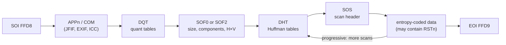
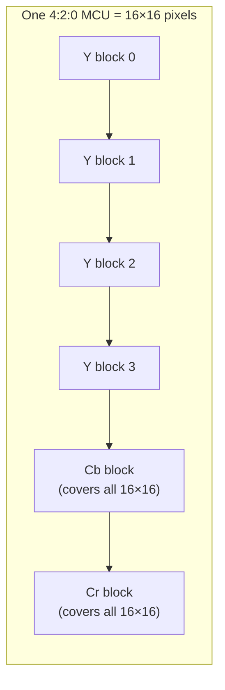
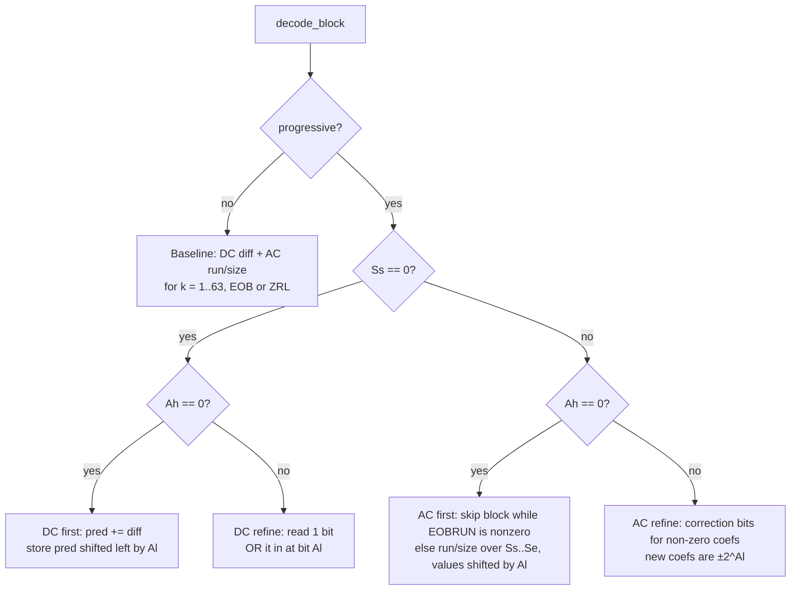
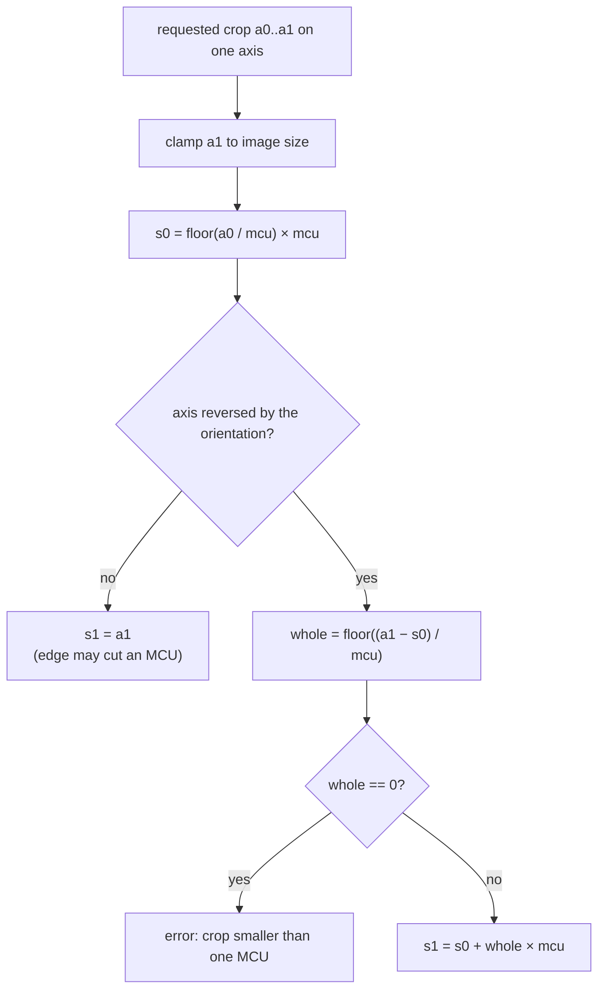

# Lossless JPEG transcoder

This module crops, rotates and flips a JPEG without recompressing it. It decodes the file only as far as the quantised DCT coefficients, rearranges those coefficients, and writes a new baseline JPEG with freshly optimised Huffman tables. No pixel is ever computed, so no rounding happens and there is no generational loss. The web app calls it for the "lossless JPEG" export, through `jpeg_info` and `jpeg_lossless` in `core/src/lib.rs`.

## Files

| File | Role |
|------|------|
| `mod.rs` | Module overview, the `ZIGZAG` table, and the public entry points: `info`, `transform`, `decode_coefficients`, `transform_coefficients`. |
| `bitio.rs` | `BitReader` and `BitWriter`: MSB-first bit streams with `0xFF 0x00` byte stuffing and restart-marker handling. |
| `huffman.rs` | `Decoder` (canonical Huffman decoding, with a 9-bit lookup table), `Encoder::optimal` (Annex K.2 table building), `extend` and `category`. |
| `parse.rs` | Marker walking, `DQT`/`DHT`/`SOF`/`SOS` parsing, and entropy decoding of baseline and progressive scans into a coefficient buffer (`decode`, `ScanDecoder::decode_block`). |
| `transform.rs` | `snap_crop` (snaps a crop to the MCU grid) and `apply` (moves blocks and transforms coefficients inside them). |
| `write.rs` | `write`: emits a single-scan baseline JPEG in two passes (count symbols, then encode). |
| `exif.rs` | Finds and rewrites the EXIF Orientation tag (`0x0112`) in IFD0. |
| `core/tests/lossless_jpeg.rs` | End-to-end tests over all 8 orientations, baseline and progressive, 4:4:4, 4:2:2 and 4:2:0, with and without restart intervals. |

Suggested reading order: `mod.rs`, `bitio.rs`, `huffman.rs`, `parse.rs`, `transform.rs`, `write.rs`, `exif.rs`.

## How it works

### Why re-saving a JPEG loses quality

A JPEG encoder converts the image to Y'CbCr, optionally subsamples the chroma, cuts each component into 8×8 blocks, and takes the 2-D DCT of each block. Every one of the 64 DCT coefficients is then divided by an entry of a *quantisation table* and rounded to an integer. That rounding is where the loss happens. A decoder multiplies back and runs an inverse DCT, which rounds again to get 8-bit pixels. If you decode, edit and re-encode, you round a second time, and each later save rounds again.

The quantised integers are the real content of the file. Everything after them (zigzag ordering, run-length coding, Huffman coding) is lossless. So if we read the integers, move them around exactly, and write them back with new lossless coding, the picture is unchanged. libjpeg's `jpegtran` works the same way.

### File structure: markers and segments

A JPEG file is a sequence of *markers*: a `0xFF` byte followed by a code byte. Most markers start a segment and are followed by a 2-byte big-endian length, which counts itself but not the marker. `parse.rs` → `next_segment` walks them, skipping any extra `0xFF` fill bytes. SOI, EOI and RST0–RST7 have no length.

| Marker | Code | Content | What this module does with it |
|--------|------|---------|-------------------------------|
| SOI | `FFD8` | start of image | must come first |
| APP0–APP15 | `FFE0`–`FFEF` | JFIF, EXIF, ICC profile, Adobe… | copied to the output (`JpegFile::segments`) |
| COM | `FFFE` | comment | copied |
| DQT | `FFDB` | quantisation tables, 8- or 16-bit, in zigzag order | stored in natural order in `JpegFile::qtables` |
| SOF0 / SOF1 / SOF2 | `FFC0`–`FFC2` | frame header: precision, size, components, sampling factors, quant table per component | `parse_sof`; SOF2 sets `Header::progressive` |
| DHT | `FFC4` | Huffman tables | built into `Decoder`s, DC and AC classes, ids 0–3 |
| DRI | `FFDD` | restart interval, in MCUs | used while decoding |
| SOS | `FFDA` | start of scan, then entropy-coded data | decoded by `ScanDecoder` |
| RST0–RST7 | `FFD0`–`FFD7` | restart markers inside scan data | `BitReader::restart` |
| EOI | `FFD9` | end of image | stops parsing (a missing EOI is tolerated) |

`parse_sof` and `unsupported_sof` reject everything except 8-bit Huffman-coded sequential or progressive frames. That excludes 12-bit, lossless (`C3`, `C7`, `CB`, `CF`), hierarchical (`C5`, `C6`, `CD`, `CE`) and arithmetic-coded (`C9`, `CA`, and `CC` DAC) files, plus files whose height is deferred to a DNL marker.



**Byte stuffing.** Inside the entropy-coded data, a `0xFF` byte would look like the start of a marker. So whenever the encoder produces a data byte `0xFF`, it writes `0xFF 0x00`, and the decoder drops the `0x00`. `BitReader::fill` does the unstuffing. When it meets `0xFF` followed by anything other than `0x00`, it sets `at_marker` and feeds zero bits from then on. `BitWriter::put` does the stuffing, and `BitWriter::finish` pads the last byte with 1-bits as the standard requires. `parse::decode` finds the end of a scan by looking for the first `0xFF xx` where `xx` is neither `0x00` nor an RST code.

**Restart markers.** If DRI sets an interval *n*, the encoder byte-aligns the data and inserts `RSTm` after every *n* MCUs, and resets the DC predictions. A damaged file can resynchronise at the next marker. `ScanDecoder::decode_scan` counts units and, at each boundary, calls `BitReader::restart` and resets both `preds` and `eobrun`.

### Components, sampling factors, MCUs and blocks

Each component (Y, Cb, Cr) has sampling factors `h` and `v` (`ComponentInfo`). `hmax` and `vmax` are the largest of these. A component with `h = 1` when `hmax = 2` has half the horizontal resolution. An *MCU* (minimum coded unit) covers `8·hmax × 8·vmax` pixels (`Header::mcu_width`, `mcu_height`) and holds `h × v` blocks of every component.

| Sampling | Y `h×v` | Cb, Cr `h×v` | MCU in pixels | Blocks per MCU |
|----------|---------|--------------|---------------|----------------|
| 4:4:4 | 1×1 | 1×1 | 8×8 | Y, Cb, Cr |
| 4:2:2 | 2×1 | 1×1 | 16×8 | Y Y, Cb, Cr |
| 4:2:0 | 2×2 | 1×1 | 16×16 | Y Y Y Y, Cb, Cr |

The image is padded out to whole MCUs. `Header::padded_blocks` gives the stored block grid for a component. `JpegFile::coefs` keeps one `Vec<i16>` per component, 64 coefficients per block, in natural row-major order (`index = v·8 + u`, `u` horizontal frequency, `v` vertical). A single-component (greyscale) image always codes block by block, so `parse_sof` forces its factors to 1×1.



An *interleaved* scan (several components) goes MCU by MCU in that order. A *non-interleaved* scan (one component) goes block by block in raster order over only the blocks that actually cover pixels (`Header::real_blocks`), not the MCU padding. That distinction matters for progressive files, and `decode_scan` and `write::encode_scan` handle both.

### Coefficients on the wire: zigzag, DC prediction, run/size coding

**Zigzag.** Inside a block, coefficients are sent in zigzag order, from low to high frequency, so that the zeros that quantisation leaves at high frequencies end up in one long tail. `mod.rs` → `ZIGZAG[k]` is the natural index of the k-th coefficient sent: `0, 1, 8, 16, 9, 2, 3, 10, …, 63`.

**DC prediction.** Coefficient 0 (DC, the block average) is coded as the difference from the previous block's DC in the same component (`ScanDecoder::preds`, `write::encode_block`'s `pred`). Neighbouring averages are similar, so the differences are small.

**Category and extra bits.** Each value is sent as a Huffman-coded *category* `s` (the number of bits in its magnitude, `huffman.rs` → `category`) followed by `s` raw bits. Positive values are sent as is. A negative value `v` is sent as the low `s` bits of `v − 1`, which always starts with a 0 bit (`write.rs` → `magnitude_bits`). `huffman.rs` → `extend` reverses this: if the top bit is 0, the value is `bits − 2^s + 1`.

**AC run/size symbols.** For the 63 AC coefficients, each Huffman symbol is one byte `RRRRSSSS`: the number of zeros skipped (0–15) and the category of the next non-zero value. Two symbols are special: `0x00` = EOB (the rest of the block is zero) and `0xF0` = ZRL (sixteen zeros, nothing else).

**Huffman tables.** A DHT segment lists `bits[1..=16]`, the number of codes of each length, followed by the symbols in code order. The codes are *canonical*: within one length they are consecutive integers, and moving to the next length appends a 0 bit (`code <<= 1`). So the counts alone define every code (`Encoder::from_spec`, T.81 Annex C). `Decoder::decode` first looks up the next 9 bits (`FAST_BITS`) in a table, which covers most codes in practice, and falls back to the `maxcode`/`valptr`/`mincode` procedure of T.81 F.2.2.3 for longer codes.

### Worked example: a block before and after a horizontal flip

Take a luma block with only four non-zero coefficients, written `S[v][u]`:

```text
S[0][0] = 40   (DC)            natural index 0
S[0][1] = 12   (u=1, v=0)      natural index 1   zigzag k=1
S[1][1] = -3   (u=1, v=1)      natural index 9   zigzag k=4
S[0][2] =  1   (u=2, v=0)      natural index 2   zigzag k=5
```

Say the previous Y block's DC was 36. `encode_block` produces:

```text
DC: diff = 40 − 36 = 4        category 3   symbol 3      extra bits 100
AC k=1:  12, run 0            category 4   symbol 0x04   extra bits 1100
AC k=2,3 are zero; k=4: −3, run 2
                              category 2   symbol 0x22   extra bits 00   (−3 − 1 = −4 → low 2 bits 00)
AC k=5:  1, run 0             category 1   symbol 0x01   extra bits 1
k=6..63 all zero              EOB          symbol 0x00   no extra bits
```

Each symbol is replaced by its Huffman code from the table in use, and the extra bits follow it directly.

Now mirror the block left to right. The horizontal DCT basis is `cos((2x+1)·u·π/16)`. Replacing `x` with `7 − x` gives `cos(u·π − (2x+1)·u·π/16) = (−1)^u · cos((2x+1)·u·π/16)`. So mirroring multiplies every coefficient with odd `u` by −1 and leaves the rest alone:

```text
S'[0][0] =  40   (u=0, unchanged)
S'[0][1] = −12   (u=1, negated)   category 4, extra bits 0011  (−13 → low 4 bits 0011)
S'[1][1] =   3   (u=1, negated)   category 2, extra bits 11
S'[0][2] =   1   (u=2, unchanged)
```

The run/size symbols (`0x04`, `0x22`, `0x01`, `0x00`) are the same. Only the sign bits changed. A flip never changes a block's AC symbol statistics, but it does reorder the blocks, which changes the DC differences. A transpose changes the zigzag positions and therefore the runs. That is why `write.rs` rebuilds the Huffman tables anyway.

### Progressive JPEG

A progressive file (SOF2) sends the same coefficients spread over several scans, so a browser can show a coarse image early. Each SOS header carries four extra parameters, kept in `parse.rs` → `Scan`:

- **Spectral selection** `Ss..=Se`: which zigzag positions this scan covers. A DC scan has `Ss = Se = 0`. An AC scan covers a band such as 1–5 or 6–63 and may contain only one component.
- **Successive approximation** `Ah`, `Al`: the scan sends values shifted right by `Al` bits. `Ah = 0` means a first pass. `Ah > 0` means a refinement that adds the one bit at position `Al`.

The decoder can't do anything useful with one scan's data alone, so `parse::decode` accumulates every scan into the same `coefs` buffer and only then hands the finished coefficients to the transform. `ScanDecoder::decode_block` has five branches:



**EOBRUN.** In a progressive AC band, many consecutive blocks are entirely zero. Instead of one EOB per block, a symbol with size 0 and run `r < 15` means "EOB*r*". It is followed by `r` extra bits, and together they encode a run length `2^r + extra` of blocks whose band is all zero, counting the current block. In the first-pass branch the code sets `eobrun = 2^r − 1 + extra`, the number of *further* blocks to skip, and each later call decrements it and returns at once. In the refinement branch it sets `eobrun = 2^r + extra` and decrements at the end of the block, because blocks inside a run still need correction bits for coefficients that are already non-zero.

**Refinement scans** (T.81 G.1.2.3) are the subtle part. For each run/size symbol, the decoder walks forward through the band. Every coefficient that is already non-zero consumes one correction bit and does not count toward the run of zeros. The new coefficient, if any, lands on the first zero position after the run and is `±(1 << Al)`. The closure `refine` adds `1 << Al` in the direction of the existing sign when the bit is set.

### From coefficients to a transform: `transform.rs`

#### Cropping on the MCU grid

Blocks are independent apart from DC prediction, and DC prediction is recomputed when we re-encode. So a crop that keeps a rectangle of whole blocks is exact. The crop's top-left corner must sit on the **MCU** grid, not merely the 8-pixel block grid, because with subsampling a single chroma block spans a whole MCU (16 pixels wide in 4:2:0), and we can't split it.

The bottom-right corner can be anywhere. The output header simply states a smaller width and height, and decoders already ignore pixels past that edge, just as they ignore the source's own MCU padding.

#### Why reversed axes need whole MCUs

A flip or rotation can carry the source's right or bottom edge to the output's left or top. Those edges are where the source has partial MCUs: real pixels followed by padding that no decoder ever shows. After the flip, the padding would sit at the output's top-left, which is always displayed. So on any axis that ends up reversed, the crop size must also be a whole number of MCUs. Then the reversed edge falls on an MCU boundary and no padding enters the picture.

`Orientation::source_x_reversed` and `source_y_reversed` in `core/src/geometry.rs` say which source axes end up reversed (for a transpose, the source's x-axis becomes the output's y-axis, so it checks `flip_y`). `transform.rs` → `snap_crop` applies the rule on each axis:



The test `snapping_follows_the_mcu_grid` shows this on a 203×141 4:2:0 image (16×16 MCUs) with the request `x 37..190, y 21..141`:

```text
identity:     x 32..190, y 16..141    left/top snap down, right/bottom untouched
rotate 180°:  x 32..176, y 16..128    (190−32)/16 = 9 MCUs → 144 px, (141−16)/16 = 7 MCUs → 112 px
```

The snapped rectangle is returned to the UI as `Output::source_rect`, so the user sees the crop that was actually used.

#### Flips and transposes inside a block

`transform.rs` → `apply` uses the same convention as `geometry.rs`: transpose first, then flip x, then flip y. Every output coefficient is

```text
OUT[v][u] = (−1)^(u·flip_x) · (−1)^(v·flip_y) · (transpose ? S[u][v] : S[v][u])
```

The flip terms come from the worked example above, along each axis. A transpose swaps the roles of x and y in the separable 2-D DCT, so it transposes the coefficient matrix. For example, EXIF orientation 6 (rotate 90° clockwise) is `transpose + flip_x`, so `OUT[v][u] = (−1)^u · S[u][v]`.

Two things in the header have to follow the coefficients when they are transposed:

- **Quantisation tables.** Coefficient `S[u][v]` was quantised with `Q[u][v]`. After the transpose it sits at `[v][u]`, so the decoder must multiply it by `Q[u][v]` there. `apply` transposes every table in `qtables`.
- **Sampling factors.** A 4:2:2 image (luma 2×1, MCU 16×8) becomes luma 1×2 with an 8×16 MCU. `apply` swaps `h` and `v` for every component and swaps `hmax` and `vmax`.

Between blocks, whole blocks move like pixels: `apply` maps each output block position back to a source block with the same flip/transpose arithmetic as `geometry.rs` → `orient_buffer`, offset by the crop origin in that component's block grid (`bx0 = crop.x0 / mcu_width · h`). Output blocks that map beyond the source's padded grid are left zero. They lie outside the output's visible area.

### Re-encoding: `write.rs`

The output is always a single-scan, sequential baseline JPEG, even if the input was progressive. This keeps the writer small, and baseline is decoded everywhere.

```mermaid
flowchart LR
    IN["input bytes"] --> DEC["parse::decode<br/>all scans to coefs"]
    DEC --> SNAP["transform::snap_crop"]
    SNAP --> APP["transform::apply<br/>move blocks, flip signs,<br/>transpose coefs + qtables"]
    APP --> P1["write pass 1: Counter<br/>count DC and AC symbols"]
    P1 --> OPT["Encoder::optimal<br/>(Annex K.2)"]
    OPT --> HDR["SOI, APPn (EXIF reset),<br/>DQT, SOF0/SOF1, DHT, SOS"]
    HDR --> P2["write pass 2: Emitter<br/>Huffman codes + extra bits"]
    P2 --> OUT["EOI, output bytes"]
```



**Two passes through one function.** `encode_scan` and `encode_block` are written once against the `Sink` trait. The `Counter` sink only tallies symbols. The `Emitter` sink writes codes and extra bits through a `BitWriter`. Luma (component 0) uses table 0 and all chroma components share table 1, for both DC and AC.

**Optimal Huffman tables** (`huffman.rs` → `Encoder::optimal`, T.81 Annex K.2). This is Huffman's algorithm, tracking only code lengths:

1. Add a reserved symbol 256 with frequency 1, so that no real symbol gets the all-ones code (JPEG forbids it, because `1…1` is used for padding). An all-zero histogram gets a dummy count so the table is never empty.
2. Repeatedly merge the two least frequent nodes. `others` chains the leaves of each subtree, and every leaf in both merged subtrees gets one bit longer.
3. Count codes per length, then apply Figure K.3: while there is a code longer than 16 bits, take two codes from the longest length, put one of them one level up, and use a shorter code as the prefix for both. This keeps the prefix code complete.
4. Remove the reserved symbol from the longest length, then list symbols sorted by code length. `from_spec` turns that into canonical codes.

Optimal tables usually beat the generic tables in Annex K.3 that many cameras use. The module comment says the output is often a few percent smaller than the original.

**Header details.** `write` only emits DQT tables that some component uses. If any quantisation entry exceeds 255, it writes 16-bit tables and marks the frame SOF1 (extended sequential) instead of SOF0. It writes no DRI, so the output has no restart markers. The SOS header always has `Ss = 0, Se = 63, Ah = Al = 0`.

### EXIF orientation reset: `exif.rs`

Cameras often store pixels in sensor orientation and set the EXIF Orientation tag (1–8) to tell viewers how to rotate them. After a lossless rotation the pixels are already the right way up. If the tag still said "rotate 90°", viewers would rotate a second time. `write` therefore passes every APP1 segment that starts with `Exif\0\0` through `exif::set_orientation(&mut p, 1)` and copies all other APPn and COM segments byte for byte.

EXIF is a small TIFF file: a byte-order mark (`II` little-endian or `MM` big-endian), the number 42, an offset to IFD0, and then 12-byte entries `tag, type, count, value-or-offset`. Orientation is a SHORT, so its value sits inline in the first two bytes of the value field. `find_entry` returns that position, and `set_orientation` overwrites it in place without changing the segment's length. `find_orientation` reads the tag for `mod.rs` → `info`, which the UI uses to offer the right default orientation. `lib.rs` → `encode_jpeg` reuses the same functions when the normal (lossy) export copies EXIF.

### Testing: why compare coefficients, not pixels

`core/tests/lossless_jpeg.rs` encodes a synthetic 203×141 image (deliberately not a multiple of 8 or 16) with the `jpeg_encoder` crate at quality 85, then runs `jpeg::transform` with all 8 EXIF orientations and the crop `x 37..190, y 21..141`.

- `check` (used by `baseline_444`, `baseline_444_with_restarts`, `progressive_444`, `baseline_420`, `progressive_422`) decodes the output with the `image` crate and compares it with the original's decoded pixels after the same crop and `orient_buffer`. It requires bit-exact pixels only for 4:4:4 without a transpose. Everything else must have a mean difference below 1 level.
- `coefficients_are_exact` is the real losslessness check. For 4:4:4 baseline, 4:2:0 progressive and 4:2:2 baseline, all with restart interval 7, it re-parses the written file and asserts that every real block's coefficients and every quantisation table equal `jpeg::transform_coefficients` applied to the input.
- `identity_roundtrip` transforms a whole progressive 4:2:0 file with the identity orientation and checks that the coefficients and the decoded pixels both match the original.

Pixel comparison can't be exact in general for two reasons, both outside this module. Fast integer IDCTs do the row pass and the column pass with different intermediate rounding, so a transposed block can decode one or two levels differently even though its coefficients are identical. And decoders that smooth chroma upsampling look at neighbouring blocks, which change at the new image edges. Comparing coefficients tests exactly what the module promises: the quantised data is unchanged.

## Design choices and trade-offs

- **Decode everything to a full coefficient buffer.** Progressive files need it anyway, and it makes the transform a simple array remapping. Memory use is 128 bytes per block per component (64 × `i16`), about 3 bytes per pixel for 4:2:0 and 6 for 4:4:4. That is acceptable in a browser worker.
- **Always write baseline.** One writer with one scan type is much simpler than re-creating a progressive scan script. Baseline is universally supported, and the optimal tables keep the size competitive. The cost is that the "progressive loading" behaviour of a progressive original is lost.
- **Drop restart markers.** The output is a local file, not a stream over a lossy channel, so resynchronisation points add size for no benefit.
- **Snap instead of trim.** `jpegtran` offers `-trim` (drop the partial edge MCUs) and `-perfect` (fail instead). `snap_crop` always grows the crop's left/top edge to the MCU grid and shrinks a reversed axis to whole MCUs, and reports the result through `Output::source_rect`. The UI can show the user the exact rectangle.
- **Minimal EXIF edit.** Only the Orientation value is changed, in place. The EXIF thumbnail and the `PixelXDimension`/`PixelYDimension` tags are copied unchanged, so they still describe the original image. Rewriting them would need a real TIFF writer.
- **Fast-path Huffman decoding.** A 512-entry lookup table (`FAST_BITS = 9`) resolves most codes in one step. The spec's bit-by-bit procedure is kept as the fallback, and it is readable next to T.81 F.2.2.3.
- **Simple O(n²) tree building.** `Encoder::optimal` scans all 257 entries to find the two smallest, as Annex K.2's flowcharts do, instead of using a heap. With at most 257 symbols this costs nothing and is easy to check against the spec.
- **Strict input support.** Arithmetic coding, 12-bit precision, lossless and hierarchical modes, and DNL-defined heights are rejected with a clear error from `info`, so the UI can fall back to a normal lossy export.

## Further reading

- ITU-T Recommendation T.81 / ISO/IEC 10918-1, *Digital compression and coding of continuous-tone still images* (1992). Annex B (syntax), Annex C (Huffman table specification), Annex F (sequential), Annex G (progressive), Annex K.2 (optimal tables). Stable copy: <https://www.w3.org/Graphics/JPEG/itu-t81.pdf>
- Eric Hamilton, *JPEG File Interchange Format*, version 1.02 (1992): <https://www.w3.org/Graphics/JPEG/jfif3.pdf>
- CIPA DC-008, *Exchangeable image file format for digital still cameras: Exif* (the Orientation tag and APP1 layout), and Adobe's *TIFF Revision 6.0* for the IFD structure.
- W. B. Pennebaker and J. L. Mitchell, *JPEG Still Image Data Compression Standard*, Van Nostrand Reinhold, 1993.
- G. K. Wallace, "The JPEG Still Picture Compression Standard", *Communications of the ACM* 34(4), 1991.
- Independent JPEG Group, libjpeg: `jpegtran` and `transupp.c` are the prior art for lossless transforms, and `jchuff.c` implements the same Annex K.2 table builder. <https://ijg.org/>
- D. A. Huffman, "A Method for the Construction of Minimum-Redundancy Codes", *Proceedings of the IRE* 40(9), 1952.
