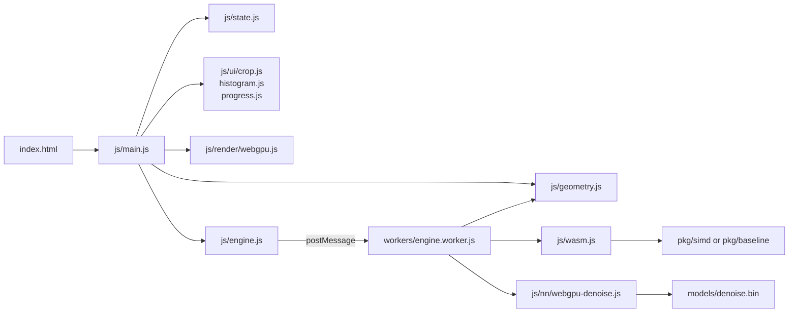
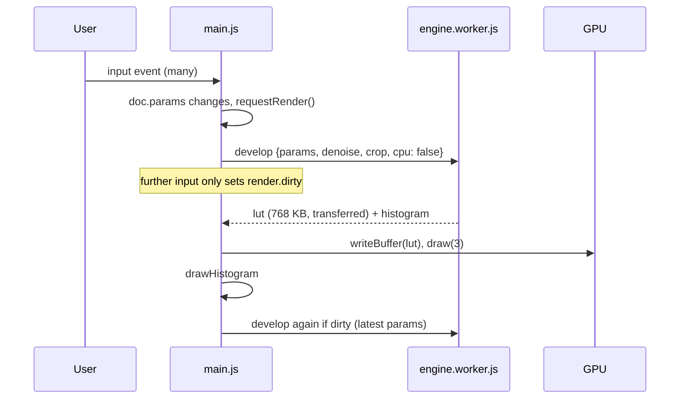
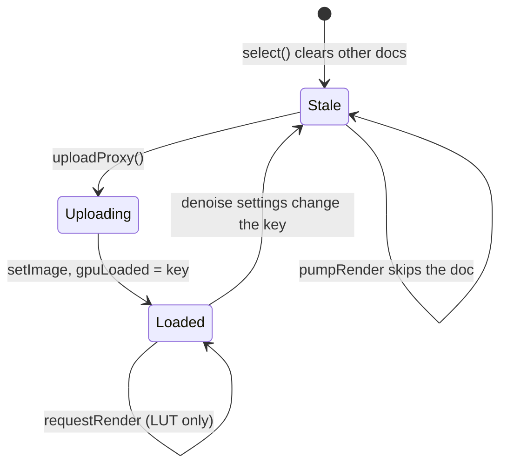
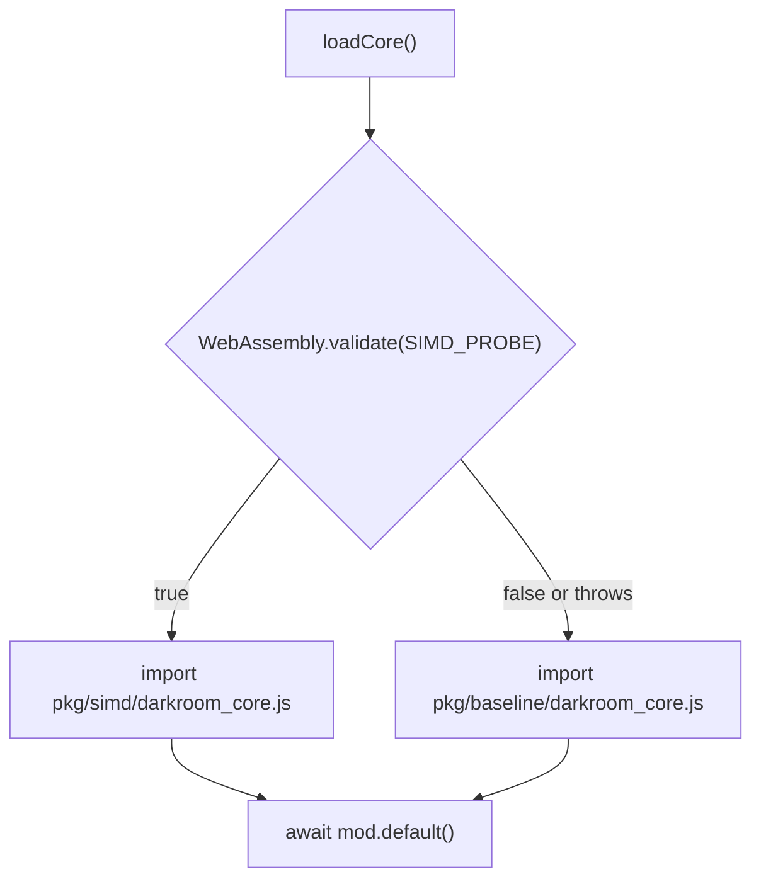

# Web front end

The browser side of Darkroom: a static page (`index.html`, `style.css`) and ES modules in `js/` that run the UI on the main thread, draw the live preview with WebGPU (or Canvas 2D), and talk to the engine worker in `workers/`, which holds all the pixels. There is no bundler and no framework. The browser loads the files as they are, and the Rust core arrives as WebAssembly in `pkg/`.

## Files

| File | Role |
|---|---|
| `index.html` | Page structure: the image stage on the left, the adjustment panel on the right, the help dialog, the hidden file input. Loads `js/main.js` as a module. |
| `style.css` | Layout and look. Neutral greys only, so the UI chrome does not bias your colour judgement. |
| `js/main.js` | UI controller: DOM events, documents, the render pump, loupe, export, keyboard. |
| `js/state.js` | The document model (`createDoc`), default develop and denoise settings, aspect presets (`ASPECTS`). |
| `js/geometry.js` | Orientation as 2×2 signed permutation matrices, crop transforms, JPEG block-grid snapping. The twin of `core/src/geometry.rs`. |
| `js/engine.js` | `Engine`: promise-based RPC client for `workers/engine.worker.js`. |
| `js/wasm.js` | `loadCore`: picks the SIMD or baseline wasm build by feature detection. Used by the workers, not the UI thread. |
| `js/render/webgpu.js` | `createGpuRenderer`: the WebGPU preview (proxy texture + LUT + fragment shader). |
| `js/nn/webgpu-denoise.js` | `createGpuDenoiser`: the denoising CNN as WebGPU compute shaders. Imported by the engine worker. |
| `js/ui/crop.js` | Crop rectangle maths (`fitAspect`, `dragCrop`) and pointer handling (`attachCropOverlay`). |
| `js/ui/histogram.js` | `drawHistogram`: draws the 4 × 256 bins the engine computes. |
| `js/ui/progress.js` | `createProgressBar`: one thin bar shared by every long task. |
| `workers/` | Engine worker, compute workers and the pool. See [`workers/README.md`](workers/README.md). |
| `models/denoise.bin` | Weights of the denoising network (DRNN format, documented in `core/src/denoise/neural.rs`). |
| `pkg/simd/`, `pkg/baseline/` | wasm-bindgen output from `build.sh`. Built, not committed (`.gitignore` lists `/web/pkg`). |

## How it works

### Layout: image first

`index.html` has two regions inside `#app` (a flex row):

- `#stage`, the image area. It holds `#viewport` (two canvases, `#canvas-gpu` and `#canvas-cpu`, only one of which is shown, plus the `#crop` overlay), the `#loupe` canvas, the empty-state drop prompt, the `#progress` bar, a `#toast`, and the `#filmstrip`.
- `#panel`, a fixed 288 px column (`--panel-w`) of collapsible `<details>` sections: Film, Noise, Light, Colour, Crop & rotate, Export.

Controls are bound by data attributes rather than IDs: `data-param` (develop parameters), `data-denoise`, `data-denoise-method`, `data-film`, `data-tool`, `data-op`. Panel modes are CSS classes on `#panel` (`is-negative`, `is-denoising`, `is-jpeg`) that show or hide `.negative-only`, `.denoise-on` and `.jpeg-only` blocks. Below 720 px wide the panel becomes a sheet under the image. Tab hides the panel entirely.

`main.js` `layout` sizes `#viewport` to the largest box with the aspect of the visible region (the whole image while cropping, otherwise the crop) that fits the stage minus a margin and the filmstrip. It then sets the canvas backing store to CSS size × `devicePixelRatio`, so the preview is drawn at device resolution. A `ResizeObserver` on `#stage` re-runs `layout`.

### Documents and state

`state.js` `createDoc(file)` makes one record per dropped file: `params` (mirrors `Params` in `core/src/develop/params.rs`, sent as JSON), `denoise` (mirrors `DenoiseParams`), `orientation` (an EXIF code 1–8, the file's own orientation composed with user rotations), `crop` (`[x0, y0, x1, y1]` in *displayed* normalised coordinates), `aspect`, and `status` (`loading`, `ready` or `error`). Pixels are never stored here. They live in the engine worker, addressed by `doc.id`.

`main.js` `addFiles` queues decodes on a promise chain (`loadChain`), so a dropped roll is decoded one file at a time to bound peak memory. `load` reads the `File` into an `ArrayBuffer` and transfers it to the engine with `engine.call('open', …, { transfer: [bytes] })`.

### The render pump

A slider can fire `input` events far faster than a develop round trip. `main.js` coalesces them with two flags:

```js
requestRender():  render.dirty = true; if (!render.inflight) pumpRender()
pumpRender():     inflight = true
                  while (dirty) { dirty = false; await engine.call('develop', …); draw }
                  inflight = false
```

However many events arrive during one round trip, they collapse into a single further iteration, which reads the *latest* `doc.params`. No stale work is ever queued. If the CPU path's bitmap comes back at the wrong size (the canvas was resized meanwhile), the pump sets `dirty` again and loops.

What `develop` returns depends on the renderer:

- **WebGPU:** only the tone LUT (3 × 65536 `f32`, 768 KB) and a histogram. `app.gpu.setLut` uploads it and `drawGpu` issues one draw.
- **Canvas 2D:** the engine renders the visible region at canvas size in wasm and sends an `ImageBitmap`, which `pumpRender` draws with `drawImage`.

Crop, rotate and panning only need `drawGpu` on the WebGPU path, because the view rectangle and orientation are shader uniforms.

### uploadProxy and the gpuLoaded key

With WebGPU the proxy image (screen-sized, 16-bit RGBA) lives on the GPU as a texture. Noise reduction changes those pixels, so the texture must be re-uploaded when the denoise settings change. `uploadProxy(doc)` asks the engine for the proxy (`engine.call('proxy', { docId, denoise })`), uploads it with `app.gpu.setImage`, and records which settings it holds:

```js
doc.gpuLoaded = JSON.stringify(denoiseFor(doc))
```

`pumpRender` skips a document whose `gpuLoaded` does not match the current key. Otherwise it would draw a new LUT over a texture from the old denoise settings. The callers that change the key (`select`, `denoiseChanged`) call `uploadProxy` first and then `requestRender`. `select` also clears `gpuLoaded` on every other document, because the GPU holds only one texture.

`denoiseFor(doc)` builds that key. When noise reduction is on, it adds `negative: doc.params.negative`, because negatives are denoised in optical density and positives in gamma space (see `core/src/denoise/mod.rs`), so the film type changes the denoised pixels. When the method is `off` it leaves `negative` out. Otherwise toggling Positive/Negative would change the key without anything re-uploading, and the pump would skip forever.

### Loupe

The main preview shows a proxy, and downscaling averages noise away, so noise reduction can only be judged at 100 %. `openLoupe` (Z or double-click) stores a centre point. `renderLoupe` asks for a region of exactly one image pixel per device pixel, `min(screen, image)` in each axis, clamps the centre so the region stays inside the image, and calls `engine.call('loupe', …)`. The engine renders it from the full-resolution master, denoising only that region plus a margin. Dragging the loupe moves the canvas with a CSS `transform` for instant feedback. On `pointerup` the drag is converted to a new centre (`dx / W`, in image pixels) and the loupe is re-rendered.

### Export

`exportDoc` sends `export` with the document's params, `denoiseFor(doc)`, orientation, crop, and the panel's format options. `runExport` loops over one or all documents, guarded by `app.exporting`, and shows the percentage on the Export button. The result is an `ArrayBuffer` of encoded bytes. `download` wraps it in a `Blob`, clicks a temporary `<a download>`, and revokes the object URL a minute later. Lossless JPEG files get the suffix `-crop`, all others `-darkroom`. Export preferences persist in `localStorage` under `darkroom.export`.

### Progress tracking

`ui/progress.js` `createProgressBar` keeps a `Set` of tasks. `track(label, fn)` registers a task and passes `fn` an `onProgress(fraction)` callback. `main.js` hands that straight to `engine.call(…, { onProgress })`, so progress messages from the engine worker reach the bar. The bar shows the mean of tasks that report a fraction, or an indeterminate sweep if none do. It appears only after `SHOW_AFTER = 200` ms, so quick slider renders never flash it.

### Geometry: orientation as matrices

`geometry.js` treats each of the 8 EXIF orientations as "transpose, then flip X, then flip Y". As a 2×2 matrix `A` acting on centred coordinates, `source = A · output`. Every such `A` is a *signed permutation matrix*: one ±1 per row and column. Together they form the dihedral group D4, the symmetries of a square.

```
code 1: [[ 1, 0], [0,  1]]  identity        code 6: [[0, 1], [-1, 0]]  transpose + flipX
code 3: [[-1, 0], [0, -1]]  rotate 180      code 8: [[0,-1], [ 1, 0]]  transpose + flipY
```

This gives three short operations:

- `compose(code, op)`: a user rotation or flip (`OPS.cw`, `ccw`, `flipH`, `flipV`, each "new output → old output") is a matrix product, `toMatrix(code) · OPS[op]`, then `fromMatrix` maps it back to a code.
- `inverse(code)`: the inverse of an orthogonal matrix is its transpose. Only codes 6 and 8 (the 90° rotations) differ from their own inverse.
- `transformCrop(crop, op)`: moves the crop with the image by applying `transpose(OPS[op])` to its corners about the centre (0.5, 0.5).

`cropToSource` maps a displayed crop to source-normalised coordinates through `mapNormalized`. `toPixels` rounds the result to whole pixels. `snapCropToGrid` serves lossless JPEG: a JPEG can only be cropped without re-encoding on its MCU grid (8 or 16 px blocks, see `core/src/jpeg/transform.rs`). The function maps the crop into source space, rounds each edge to a multiple of `mcuW`/`mcuH` (keeping the image edge when within half a block of it), and maps back with the inverse orientation.

### Engine client and wasm loading

`engine.js` `Engine` wraps the worker in RPC. `call(type, payload, { transfer, onProgress })` waits for the worker's `{ ready: true }` message, assigns an `id`, stores the resolve/reject pair in `pending`, and posts `{ id, type, payload }` with the `transfer` list. Replies carry either `progress` (forwarded to `onProgress`, request stays pending) or `ok` with `result`/`error`.

`wasm.js` decides which build to load. `SIMD_PROBE` is a 31-byte wasm module with one function of type `[] -> [v128]` whose body is `i32.const 0`, `i8x16.splat`, `i8x16.popcnt`. `WebAssembly.validate` type-checks it without compiling or running it. If the engine knows the SIMD opcodes it validates, otherwise it does not. `loadCore` then imports `../pkg/simd/darkroom_core.js` or `../pkg/baseline/darkroom_core.js` and calls the wasm-bindgen `default()` init, which fetches `darkroom_core_bg.wasm` next to it. The probe is the same one the `wasm-feature-detect` library uses.

### WebGPU preview

`render/webgpu.js` `createGpuRenderer` returns `null` when `navigator.gpu` or an adapter is missing. `main.js` then falls back to Canvas 2D. Adding `?cpu` to the URL forces that fallback, so you can compare the two paths.

GPU resources:

- **Proxy texture**, format `rgba16uint`: the raw 16-bit code values, unfiltered. GPUs have no 3-channel texture formats, which is why the proxy is RGBA. `setImage` writes it with `bytesPerRow = width * 8`.
- **LUT storage buffer**, `3 * 65536 * 4` bytes, read in WGSL as `array<f32>`, red at offset 0, green at 65536, blue at 131072.
- **View uniform**, 48 bytes: `crop` (vec4f), `orient` (vec4u: transpose, flipX, flipY), `look` (saturation).

The vertex shader draws one oversized triangle covering the canvas (`draw(3)`, no vertex buffer). For each fragment, `fs`:

1. maps the canvas `uv` into the crop, then applies flip X/Y and transpose to get source coordinates (as in `geometry.rs`);
2. loads the four neighbouring texels with `textureLoad`, passes each through the LUT (`tap`), and blends them bilinearly. The LUT output is linear light, so interpolation happens after the LUT. That is also why the texture is an integer format with manual filtering: the hardware sampler would interpolate the code values before the lookup;
3. applies saturation around Rec.709 luminance (`0.2126, 0.7152, 0.0722`);
4. sRGB-encodes (`12.92·x` below 0.0031308, else `1.055·x^(1/2.4) − 0.055`).

This is the GPU twin of `core/src/develop/render.rs`, which the Canvas 2D path and thumbnails use, so both paths match the export.

### WebGPU denoiser

`nn/webgpu-denoise.js` runs the convolutions of the FFDNet-style network from `core/src/denoise/neural.rs`. Preparing the input (`nn_prepare`) and applying the predicted noise (`nn_finish`) stay in Rust.

- `parseWeights` reads the `DRNN` file: magic, version 1, layer count, then per layer `cin`, `cout`, weights `[cout][cin][9]` and biases.
- `packWeights` reorders weights to `[cout/4][cin][9][4]`, so one `vec4f` holds the same 3×3 tap for four output channels. The shader `conv3x3` (workgroup 8×8) computes one pixel for four output channels per invocation: `acc += input_value * weights[...]`, a scalar times a vec4, with zero padding at the borders and ReLU on every layer except the last. Dispatch: `ceil(w/8) × ceil(h/8) × cout/4`.
- Activations **ping-pong** between two storage buffers `a` and `b`, each sized for the widest layer (`maxChannels × pixels × 4` bytes). All layers are encoded into one command buffer, and only the final 12-channel output is copied into a `MAP_READ` buffer and read back with `mapAsync`. `maxPixels` caps a tile by the device's `maxStorageBufferBindingSize` (at most 256 MiB).
- A **promise queue** (`queue = job.catch(() => {})`) serialises `run` calls, because every run shares the same activation and readback buffers. The preview and the loupe can ask at the same time.

## Diagrams

Module structure:



One slider move on the WebGPU path:



The proxy texture life cycle (`doc.gpuLoaded`):



Choosing a wasm build:



## Serving and deployment

The page must be served over HTTP. ES module workers and `fetch` do not work from `file://`, and WebGPU needs a secure context (`localhost` counts as one).

- `./serve.py [port]` serves `web/` with `Cache-Control: no-store` on every response. Plain `python3 -m http.server` lets the browser cache module and worker scripts heuristically, so after an edit a worker can keep running the old code.
- `pkg/` must exist first: run `./build.sh`, which builds both variants with `wasm-bindgen --target web` (and `wasm-opt -O3` if installed).
- GitHub Pages (`.github/workflows/pages.yml`) runs the tests, builds, and publishes `web/`. Pages cannot send the `Cross-Origin-Opener-Policy` / `Cross-Origin-Embedder-Policy` headers, so the page is not cross-origin isolated and `SharedArrayBuffer` is unavailable. The worker design (`workers/README.md`) is built around that.

## Design choices and trade-offs

- **No pixels on the UI thread.** The main thread holds settings and a GPU texture, never image buffers, so input stays responsive during a 100 MB decode or an export.
- **The LUT as the contract.** All per-channel maths is tabulated once in Rust. The GPU only does geometry, interpolation, saturation and encoding. A slider move costs one 768 KB upload plus one draw, and there is no second implementation of the tone curve in WGSL to drift out of sync.
- **Integer texture, manual bilinear filter.** Four texel loads and four LUT lookups per fragment instead of one hardware sample. This costs more per pixel, but interpolating in linear light after the LUT matches what `render.rs` does.
- **Coalescing over cancelling.** `pumpRender` never aborts a request in flight. It just declines to queue more. This is simple and keeps the engine free of cancellation logic, at the cost of at most one round of latency.
- **One GPU texture.** Only the current document lives on the GPU. Switching images re-uploads the proxy, a few tens of MB at most, which keeps GPU memory flat however many files are open.
- **Two GPU devices.** The renderer (UI thread) and the denoiser (engine worker) each request their own device, because WebGPU objects cannot be shared between threads. The denoiser's output returns to the CPU anyway, to be finished in Rust and uploaded as a new proxy.
- **Two wasm builds, not one.** SIMD is universal in current browsers, but `validate` costs microseconds and the baseline build keeps older engines working.

## Further reading

- WebGPU specification: https://www.w3.org/TR/webgpu/
- WGSL specification: https://www.w3.org/TR/WGSL/
- MDN, Web Workers API: https://developer.mozilla.org/en-US/docs/Web/API/Web_Workers_API
- MDN, `WebAssembly.validate()`: https://developer.mozilla.org/en-US/docs/WebAssembly/JavaScript_interface/validate_static
- WebAssembly SIMD proposal: https://github.com/WebAssembly/simd
- wasm-feature-detect (origin of the SIMD probe): https://github.com/GoogleChromeLabs/wasm-feature-detect
- The wasm-bindgen guide: https://rustwasm.github.io/docs/wasm-bindgen/
- EXIF orientation tag: CIPA DC-008, "Exchangeable image file format for digital still cameras (Exif)", tag 0x0112 Orientation.
- K. Zhang, W. Zuo, L. Zhang, "FFDNet: Toward a Fast and Flexible Solution for CNN-Based Image Denoising", IEEE TIP 2018.
- Companion docs in this repo: `workers/README.md`, `../core/src/geometry.rs`, `../core/src/develop/render.rs`.
