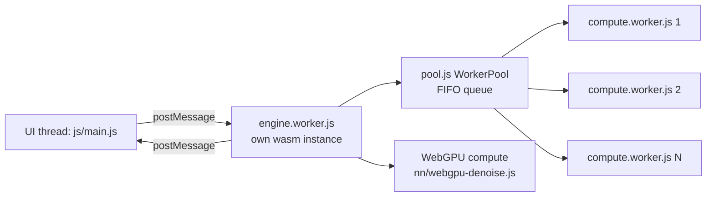
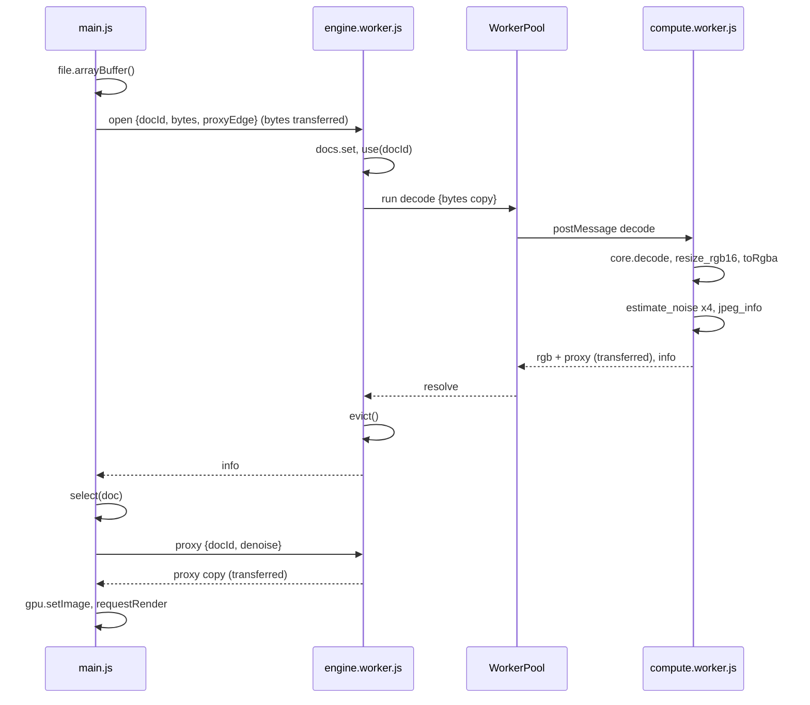
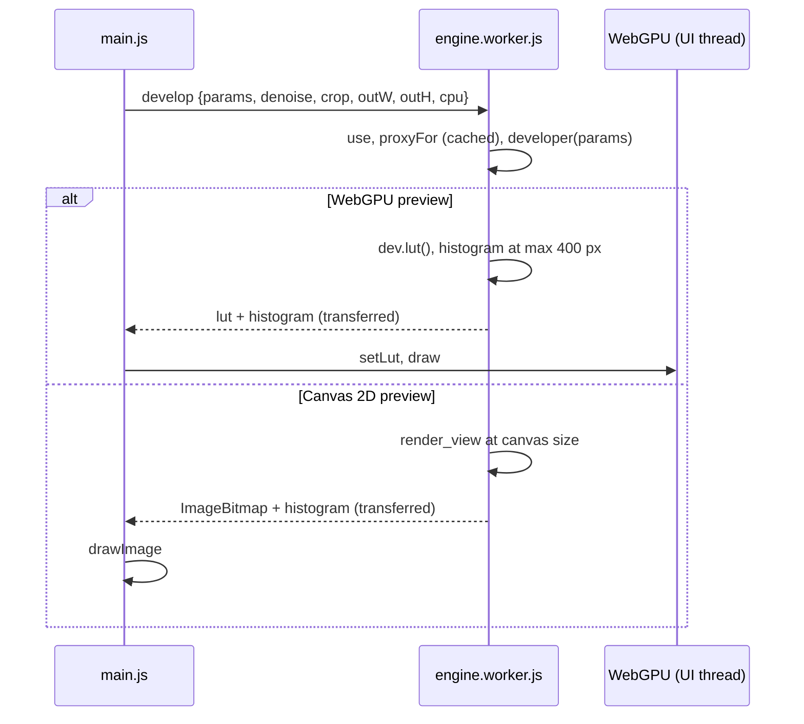
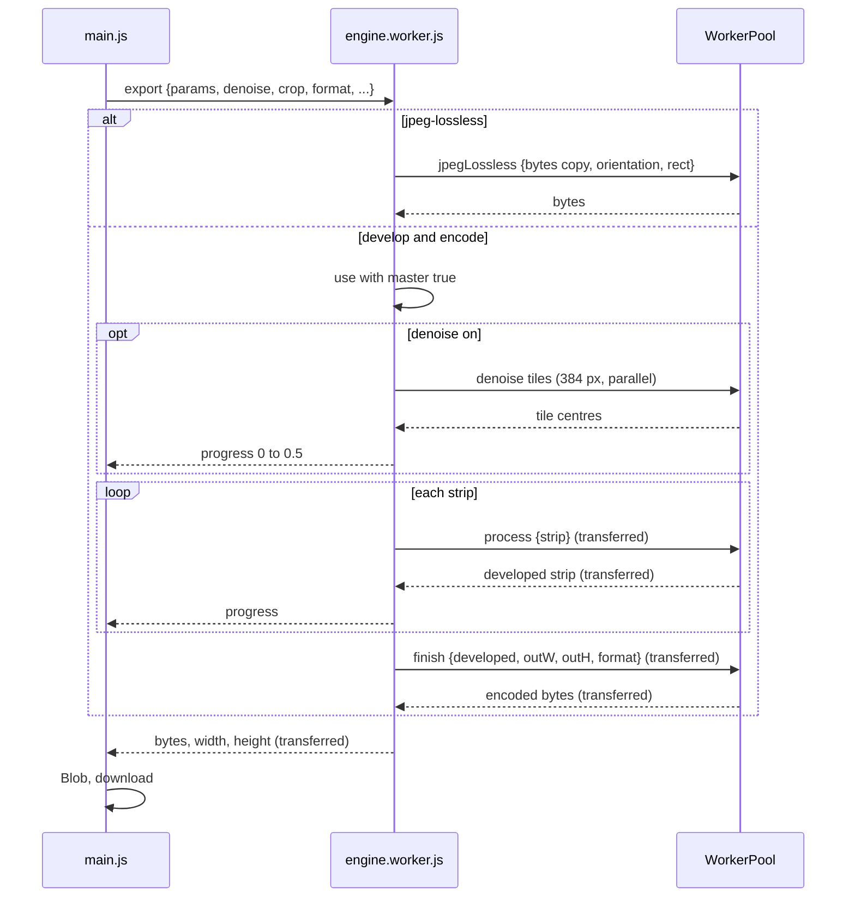
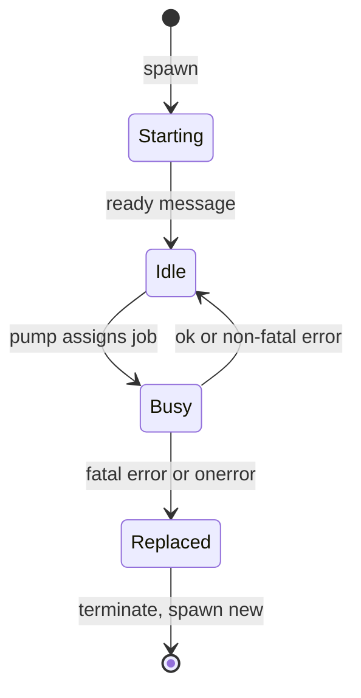

# Workers

The engine and its helpers. `engine.worker.js` is a single module worker that owns every image's pixels and answers requests from the UI thread. It does light, latency-sensitive work on its own WebAssembly instance and hands heavy work to a `WorkerPool` of `compute.worker.js` instances, each with its own copy of the wasm core. All large buffers move between threads as transferables. No memory is shared, because the site cannot be cross-origin isolated.

## Files

| File | Role |
|---|---|
| `engine.worker.js` | Owns documents (file bytes, master, proxy, noise measurements). LRU eviction, proxy and denoise cache, tiling, and the request `handlers`. Runs the WebGPU denoiser when available. |
| `compute.worker.js` | One wasm instance doing one heavy job at a time: `decode`, `denoise`, `process`, `finish`, `jpegLossless`. |
| `pool.js` | `WorkerPool`: N compute workers, a FIFO job queue, and replacement of workers that crash or trap. |

Shared code they import from `../js/`: `wasm.js` (`loadCore`, SIMD or baseline build), `geometry.js` (crop and orientation maths), `nn/webgpu-denoise.js` (the GPU network).

## How it works

### Message protocol

Both worker types speak the same request/response shape:

```
request:   { id, type, payload }                     (+ transfer list)
progress:  { id, progress: 0..1 }                    (engine only, any number)
response:  { id, ok: true, result }                  (+ transfer list)
       or  { id, ok: false, error, fatal? }          (fatal: compute workers only)
```

Each worker posts `{ ready: true }` once its top-level `await loadCore()` has finished. The compute worker also includes `simd`. Callers wait for that message before sending anything (`js/engine.js` `Engine.ready`, `pool.js` `#spawn`).

A handler returns either a plain object or `{ result, transfer }`. `engine.worker.js` `self.onmessage` checks for a `result` key to tell the two apart, and passes `transfer` to `postMessage`.

### engine.worker.js: documents and memory

`docs` maps `docId` to `{ bytes, name, proxyEdge, info, master, proxy, pw, ph, noise, denoised, lastUsed, loading }`.

- `bytes` is the original file, kept for the document's whole life. It is the source for re-decoding, lossless JPEG export and EXIF copying.
- `master` is the full-resolution 16-bit RGB image (`Uint16Array`, 3 channels). A 24 MP master takes 24 MP × 6 bytes = 144 MB.
- `proxy` is the screen-sized 16-bit RGBA copy (4 channels, so it can be uploaded straight to an `rgba16uint` texture) that drives the preview and the analysis.

`use(docId, { master })` is the single entry point to a document. It bumps `lastUsed` from a logical `clock`, re-decodes if the proxy (or, when asked, the master) has been evicted, then calls `evict()`. Concurrent callers share one decode through `doc.loading ??= decodeDoc(doc)`. `evict()` sorts documents by `lastUsed` and keeps:

```
KEEP_MASTERS = 2   most recently used masters
KEEP_PROXIES = 4   most recently used proxies (and their denoised versions)
```

Everything older is set to `null` and left to the garbage collector. Decoding is deterministic, so an evicted image comes back identical.

`developer(params)` caches one `core.Developer` (the object that owns the 3 × 65536 LUT) keyed by the params JSON, freeing the previous one with `.free()`. wasm-bindgen objects live in wasm memory and are not garbage-collected.

### The proxy cache with listeners

`proxyFor(doc, denoise, progress)` returns `doc.proxy` when noise reduction is off. Otherwise it returns a denoised copy, cached in `doc.denoised = { key, listeners, promise }` where `key = JSON.stringify(denoise)`. Several requests often need the same denoise run at once (the UI's `proxy` upload, a `develop`, a `thumb`). The first creates the promise and the rest await it. Each caller adds its `progress` callback to `listeners`, and every tile completion is broadcast to all of them, so every progress bar moves. A failed run sets `doc.denoised = null` so the failure is not cached.

### Denoise tiling

`denoiseImage(rgb, w, h, linear, denoise, noise, progress)` cuts the image into square tiles. Each tile is extracted with `margin = core.denoise_margin(params)` pixels of context on every side (the method's reach), denoised, and only its centre (`coreRect`) is pasted back. Every output pixel therefore saw the same neighbourhood it would in a whole-image run, so the seams are invisible and the result is identical.

| path | tile | scheduling | why |
|---|---|---|---|
| neural on WebGPU | 1024 | one at a time, `await gpu.run(…)` per tile | the GPU denoiser has one set of activation buffers. `nn_prepare` / `nn_finish` run on the engine's own wasm. |
| everything else | 384 | all tiles queued on the pool at once, `Promise.all` | small tiles keep N workers busy and bound per-worker memory. Each tile buffer is transferred. |

`noiseProfile(doc, denoise, which)` chooses the grain measurement for `'master'` or `'proxy'` in the right working space (`negative` selects density). If the user overrides grain size, the override, given in full-resolution pixels, is scaled by `pw / width` for the proxy.

`getGpuNet()` lazily fetches `../models/denoise.bin` and calls `createGpuDenoiser`. It resolves to `null` if there is no WebGPU or anything fails, and the pool path takes over.

### Handlers

| handler | uses | does |
|---|---|---|
| `status` | pool | Waits for `pool.ready`. Returns `{ simd, workers }` for the footer. |
| `neuralBackend` | GPU | `{ gpu: true }` if the WebGPU network loaded. |
| `open` | pool | Stores `bytes` (transferred from the UI), decodes via `use`, returns `info`. Removes the doc on failure. |
| `close` | | Deletes the doc. |
| `proxy` | cache | `proxyFor(...).slice()`, a copy, since the cache must keep its own, transferred to the UI for the GPU texture. |
| `develop` | engine wasm | GPU UI: returns `dev.lut()` plus a histogram rendered at ≤ 400 px. CPU UI (`cpu: true`): `render_view` at canvas size, an `ImageBitmap`, histogram. |
| `thumb` | engine wasm | ≤ 160 px `render_view` of the crop, PNG `Blob` from an `OffscreenCanvas`. |
| `loupe` | master | Full-resolution master. With denoise on, only the visible region plus `margin` is extracted and denoised, and the crop is re-expressed relative to that buffer (`cropToSource(rel, inverse(orientation))`). |
| `analyze` | engine wasm | `auto_negative`, `sample_density`, `neutral_balance` or `auto_levels` on the proxy, for a source-normalised `rect`. |
| `export` | pool | See below. Progress: denoise is the first half (when on), strips the rest. |
| `compareNeural` | GPU + pool | Developer check: runs the network on a ≤ 256² crop of the proxy both ways and reports `maxDiff` and timings. |

`export`, step by step:

1. `toPixels(cropToSource(crop, orientation), w, h)` gives the crop in source pixels.
2. `jpeg-lossless` short-circuits: one `jpegLossless` pool job on the file bytes, no decoding.
3. Otherwise `use(docId, { master: true })`. If denoise is on, the crop plus `margin` is denoised (`denoiseImage` on the master).
4. The crop is split into horizontal strips of `rowsPerStrip = max(16, ceil(rh / (poolSize * 4)))` rows, about four strips per worker so a slow strip doesn't leave the others idle. Each strip is a `process` job (`Developer.process_rgb16`).
5. One `finish` job resizes (in source orientation; the target size is swapped if the orientation transposes), orients with `orient_rgb16`, and encodes. If the original file starts with `FF D8` (JPEG), a copy of its bytes goes along as `exifSource`.

### compute.worker.js: the jobs

| job | input → output |
|---|---|
| `decode` | file bytes → `core.decode` (falls back to `browserDecode`, via `createImageBitmap` + `OffscreenCanvas`, for AVIF/HEIC etc.). Builds the proxy with `resize_rgb16` + `toRgba`, measures noise with `estimate_noise` on master and proxy in both working spaces, and reads `jpeg_info` for JPEGs. Transfers `rgb` and `proxy` back. |
| `denoise` | one tile with margin → `Denoiser.run` → only the `core` rectangle, transferred. |
| `process` | one RGB16 strip → developed RGB16 strip. |
| `finish` | developed crop → resize → orient → `encode_jpeg` / `encode_png` (8 or 16 bit) / `encode_tiff`. |
| `jpegLossless` | file bytes, orientation, pixel rect → `core.jpeg_lossless` (DCT-domain crop and rotate). |

Each worker caches one `Developer` per params JSON (every strip of an export uses the same LUT) and one `Denoiser`, loaded with the network weights only when a `neural` job first needs them.

If a job throws, the worker replies `ok: false`. If the error is a `WebAssembly.RuntimeError` (a trap such as out-of-bounds memory or `unreachable`), it also sets `fatal: true`. After a trap the instance's memory may be inconsistent, so it should not be reused.

### pool.js: WorkerPool

`new WorkerPool(size)` spawns `size` module workers. The engine uses `max(1, min(8, hardwareConcurrency - 1))`, leaving roughly one core for the UI and engine threads. `ready` resolves when all have posted `ready`.

- `run(type, payload, transfer)` pushes a job onto `queue` and calls `#pump`.
- `#pump` gives the head of the queue to each idle slot (`slot.busy`), posting with the job's transfer list.
- On a reply, the slot's job resolves or rejects, the slot becomes idle, and `#pump` runs again.
- **Fatal-worker replacement:** if the reply has `fatal`, or the worker fires `onerror` after start-up, `#replace` terminates it, removes the slot, and `#spawn`s a fresh worker. The job that was running is rejected, the queue survives, and the new worker joins the pool when ready. An `onerror` before the first `ready` instead rejects the spawn promise (and with it `pool.ready`).

### Transferables and why there is no SharedArrayBuffer

`postMessage(message, transfer)` normally *structured-clones* the message, a deep copy. Objects listed in `transfer` (`ArrayBuffer`, `ImageBitmap`, …) are moved instead: the receiver gets the same memory, and the sender's object is *detached* (its `byteLength` becomes 0). For a 144 MB master that is the difference between a memcpy and a pointer handoff.

That rule drives a few patterns in the code:

- **Copy before transfer when you need to keep it.** `proxy` sends `proxy.slice()`, and decode and lossless export send `doc.bytes.slice(0)`, because the engine's cached copy must survive.
- **Carve, then move.** Strips and tiles are first copied out of the master with `extract` (a row-by-row `TypedArray.set`), then the small buffer is transferred to a worker and the result transferred back.
- **wasm-bindgen return values are already copies.** A Rust `Vec<u16>` returned to JS is copied out of wasm memory into a fresh typed array, so it is safe to transfer (`dev.lut()`, `process_rgb16`, encoder output).

The alternative, one wasm instance with threads over a `SharedArrayBuffer` memory, needs the page to be cross-origin isolated: served with `Cross-Origin-Opener-Policy: same-origin` and `Cross-Origin-Embedder-Policy: require-corp`. GitHub Pages cannot set response headers, so `crossOriginIsolated` is false and `SharedArrayBuffer` is unavailable. N independent instances plus transfers give most of the parallelism, at the cost of N copies of the wasm module and the extract/paste copies around each job.

## Diagrams

Thread structure:



Open a file:



Move a slider:



Export:



Pool slot life cycle:



## Design choices and trade-offs

- **A dedicated engine thread.** Without it, pixels would sit on the UI thread or be shipped back and forth for every slider move. The engine keeps them close to its own wasm instance, so preview work (LUTs, histograms, analysis) never waits behind export jobs in the pool queue.
- **Logical-clock LRU with fixed counts** instead of a byte budget. It is simple and predictable. A roll of very large raws can still use a lot of memory (two masters plus four proxies).
- **Re-decode instead of spilling.** Evicted masters are rebuilt from the kept file bytes. Compressed files are much smaller than their decoded masters, and decoding in the pool is fast enough.
- **Tiles with margins** make tiled denoising exact rather than approximate, at the cost of re-processing the overlap (for 384 px tiles and a margin `m`, about `((384 + 2m) / 384)^2 - 1` extra work).
- **FIFO, no priorities or cancellation.** An export and a loupe denoise share the queue in arrival order. Interactive work avoids the pool where it can (`develop`, `thumb` and `analyze` run on the engine's own instance).
- **Replace on trap** rather than trying to recover a wasm instance whose linear memory may be corrupt.

## Further reading

- MDN, Web Workers API: https://developer.mozilla.org/en-US/docs/Web/API/Web_Workers_API
- MDN, Transferable objects: https://developer.mozilla.org/en-US/docs/Web/API/Web_Workers_API/Transferable_objects
- MDN, `SharedArrayBuffer` (security requirements): https://developer.mozilla.org/en-US/docs/Web/JavaScript/Reference/Global_Objects/SharedArrayBuffer
- MDN, `crossOriginIsolated`: https://developer.mozilla.org/en-US/docs/Web/API/Window/crossOriginIsolated
- HTML Standard, structured serialisation and transfer: https://html.spec.whatwg.org/multipage/structured-data.html
- WebAssembly threads proposal: https://github.com/WebAssembly/threads
- The wasm-bindgen guide: https://rustwasm.github.io/docs/wasm-bindgen/
- WebGPU specification: https://www.w3.org/TR/webgpu/
- Companion docs: `../README.md` (front end), `../js/nn/webgpu-denoise.js`, `../../core/src/denoise/mod.rs`.
